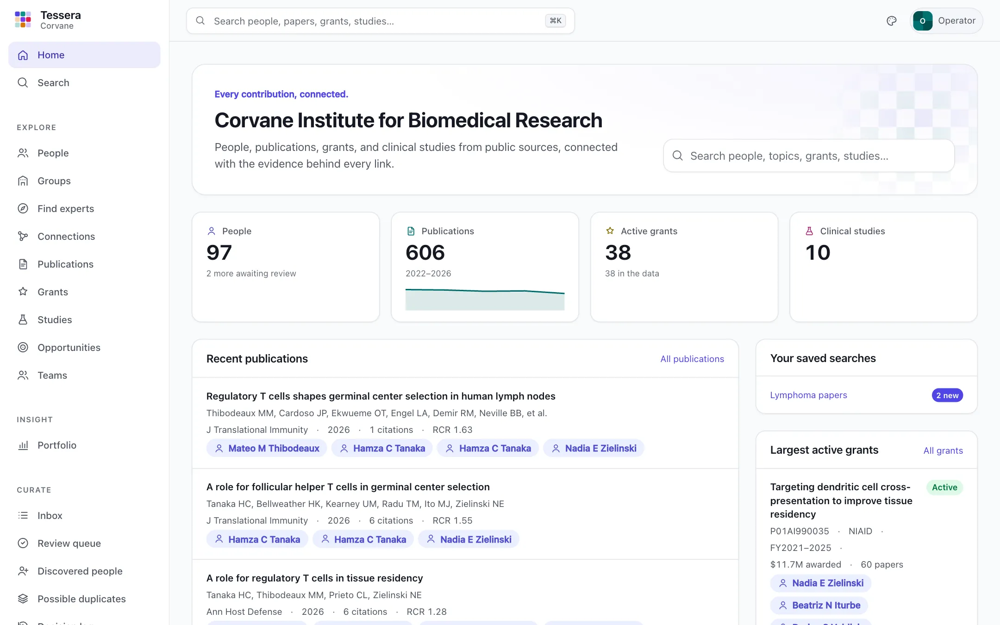

# Tessera

**Every contribution, connected.**

Tessera is an open research intelligence platform for academic research organizations. It assembles an organization's research footprint from public sources (PubMed, NIH RePORTER, ClinicalTrials.gov, iCite, ORCID, and MeSH), connects people, publications, grants, and clinical studies, shows the evidence behind every connection, helps people find who works on what and who should meet, and gives every lab, program, and division a page its own people keep, with a public site for those who opt in.

- **Starts from public data.** No HR feeds or institutional integrations needed to get going.
- **Evidence on every link.** Each connection records its source, method, likelihood, and review history.
- **Humans decide.** Automation suggests; curators confirm; decisions survive every refresh.
- **Fast to curate.** A keyboard-driven review queue, with the evidence for each suggestion on screen.
- **Open and portable.** Apache 2.0, runs on a laptop or a single server, data in open formats, re-brandable.

<p align="center">
  <picture>
    <source media="(prefers-color-scheme: dark)" srcset="docs/images/home-dark.webp">
    
  </picture>
</p>

> **Status:** version 0.4.0. It builds the research graph with evidence, supports curation with accounts and roles, finds experts and connections, gives every group a page and a public site, and now adds Insight: portfolio figures that say exactly what they count, reports that can be frozen and verified, exports that carry their definitions, and backup, restore, and a full exit export. Grant-to-impact threads, opportunities, and an optional AI assistant come next; see the [roadmap](spec/roadmap.md).

## What it does

- **Finds your organization in public records:** grants in NIH RePORTER, studies in ClinicalTrials.gov, and papers in PubMed whose authors list your organization, using a profile of how your organization's name is written.
- **Builds a people directory** from grant investigators and an optional roster, and proposes affiliated authors it discovers for you to promote or dismiss.
- **Suggests who wrote what,** scoring each candidate paper on explainable evidence: ORCID iDs and public ORCID records, email domains, affiliations, grant acknowledgments, coauthors, topics, journals, career span, and how common the name is. Weights can be learned from your own decisions, and auto-accept can be switched on where the measured precision allows.
- **Connects records:** papers to the grants they acknowledge, studies to their publications and grants, investigators to grants, and officials to studies.
- **Lets people decide,** in a review queue, on profiles, and in bulk, with every decision logged and reversible; with accounts, each person signs in and decides what their role allows. Duplicate records of one person are proposed and merged reversibly.
- **Finds expertise and connections:** "who works on X?" in plain words, each person's topics with what drives them, similar people, graphs of who works with whom and how research areas connect, pairs who share interests but have never worked together, and units compared by interest and collaboration.
- **Gives every group a home:** divisions, programs, labs, and any other kind, curated by hand or imported from your own records, nested under as many parents as they span, with members' roles and dates and alumni kept as alumni. Each group has a page its managers arrange from approved blocks (about, people, featured publications, grants, studies, themes and projects, openings, news, contact) and publish with drafts, history, and rollback. Which papers are a group's own is decided by a person, from suggestions with evidence, in a weekly inbox that also gathers new grants, roster changes, and openings closing soon.
- **Publishes a public site:** `tessera publish` writes static pages for the groups and people who opt in, with citations rather than abstracts, checked for accessibility and in the organization's own colors, and content each group can embed in its own website.
- **Shows the portfolio, honestly:** publications, funding, topics, and studies for the organization, any group, picked people, or a search, over the years you choose. Every figure carries its metric's definition and version, its cohort, its period, and its sources with their dates; money is counted per fiscal-year record without double counting; small numbers are marked; nothing ranks people. Reports can be frozen as snapshots that verify byte for byte, and every figure exports as CSV, Parquet, or JSON with its definitions and the records behind it.
- **Keeps your data yours:** `tessera backup` and `tessera restore` (between SQLite and PostgreSQL too), a full exit export in open formats, an operations view of runs and failures, and email alerts.
- **Serves a fast web app and a JSON API:** search, browsable directories with facets, profiles, record pages with provenance, and data health, in light and dark versions of three color palettes.

## Quickstart

Requires [uv](https://docs.astral.sh/uv/), which provides Python 3.12 or newer.

```bash
git clone https://github.com/robert-mcdermott/tessera.git
cd tessera
uv sync
uv run tessera init      # writes tessera.toml and a data home in ./var
```

Edit the `[organization]` section of `tessera.toml` to describe how your organization appears in public records ([how](docs/organization-profile.md)), then:

```bash
uv run tessera sync      # fetch public data, build the directory, suggest authorships
uv run tessera serve     # open http://127.0.0.1:8000
```

To look around first, `uv run tessera demo` builds an invented research institute to explore (serve it with `uv run tessera --config demo/tessera.toml serve`). Later syncs are incremental; run `sync` daily or weekly. Optional: import a roster (`uv run tessera people import roster.csv`) and set `NCBI_API_KEY` for faster PubMed requests.

## Documentation

The guides are published, with screenshots, at **[robert-mcdermott.github.io/tessera](https://robert-mcdermott.github.io/tessera/)**. In the repository:

- [Getting started](docs/getting-started.md), [Describing your organization](docs/organization-profile.md), [Curating](docs/curation.md), [Finding experts](docs/discovery.md), [Groups](docs/groups.md), [Insight](docs/insight.md), and [The public site](docs/public-site.md)
- [Configuration](docs/configuration.md), [Running Tessera](docs/operations.md), [The API](docs/api.md), and the [Command reference](docs/cli.md)
- [`spec/`](spec/README.md): vision, architecture, data model, evidence engine, roadmap, and design decisions

## Contributing

See [CONTRIBUTING.md](CONTRIBUTING.md). The test suite runs offline: `uv run pytest`.

## License

Apache License 2.0. See [LICENSE](LICENSE).
