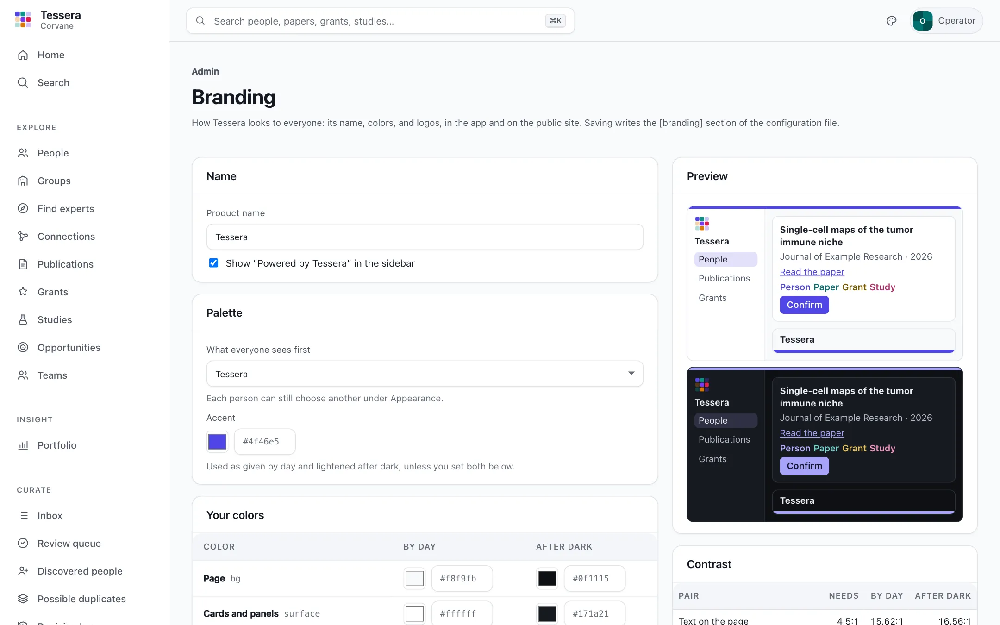

# Look and words

Tessera can carry your organization's name, colors, and logos, and call groups and the roles in them what your organization calls them. Admins set the look in the app, under **Admin → Branding**; the words are set in the configuration file, starting from a preset for your kind of organization.

## The look

**Admin → Branding** shows everything about how Tessera looks, with a preview of the app and the public site by day and after dark that changes as you edit:

- the **product name**, in the sidebar and page titles, and whether "Powered by Tessera" appears under it;
- the **palette** everyone sees first (Tessera, Harbor, or Cassette; each person can still choose another under **Appearance**), and an **accent** that replaces the palette's;
- **your colors**, by day and after dark: the page, cards, text, secondary text, lines, the accent and the text on it, the header stripe, and the colors of people, publications, grants, and studies; any you leave empty keep Tessera's;
- **logos** for light and dark backgrounds, the **browser icon**, and the **link preview** shown when someone shares a page of the public site;
- **footer links**, such as privacy and accessibility statements, at the foot of the sidebar and of every public page.



**Saving** writes the `[branding]` section of `tessera.toml` (with its `[branding.palette.day]` and `[branding.palette.night]` tables) and changes nothing else in the file. The file as it was is kept beside it as `tessera.toml.bak`, and uploaded images in a `brand/` folder beside it. Comments inside the branding tables are not kept, since the app writes them afresh; comments elsewhere are. Everyone sees the new look on their next page load, and the public site on its next `tessera publish`.

If the server cannot write the configuration file (it is on a read-only volume, say), the page says so and shows the section to copy into the file by hand. Configuration stays the record of how Tessera is set up: the app keeps no second copy.

### Contrast

Every pair of colors that carries text must meet [WCAG 2.2](https://www.w3.org/TR/WCAG22/#contrast-minimum) level AA, by day and after dark. The editor shows each pair's contrast as you change a color, and will not save while any is too low; `tessera doctor` checks the same pairs, and `tessera publish` will not publish a site whose colors fail.

| Pair | Needs |
|---|---|
| Text and secondary text, on the page and on cards | 4.5:1 |
| Links (the accent), on the page and on cards | 4.5:1 |
| Text on the accent, such as a button's label | 4.5:1 |
| The colors of people, publications, grants, and studies, on cards | 4.5:1 |
| The header stripe against the page | 3:1 |

A brand's own colors often need a darker shade for text by day and a lighter one after dark: a mid-blue that is right for a logo may be too light for links on white. Yellows and light greens rarely reach 4.5:1 on white; use them for the stripe or keep them for the logo. An accent alone is used as given by day and lightened after dark; set the accent in both columns to choose both yourself.

### Logos and images

| Image | Formats | Size |
|---|---|---|
| Logo, and logo after dark | SVG best; PNG, JPEG, or WebP | Shown at most 190 by 30 pixels in the sidebar; for PNG, export at twice that (380 by 60) or more |
| Browser icon | SVG, PNG, or ICO | Square; PNG at least 64 by 64 pixels |
| Link preview | PNG or JPEG | 1200 by 630 pixels |

- **Shape.** A horizontal logo (the mark beside the name) reads best in the sidebar. A stacked one is shown small, and when someone collapses the sidebar the logo is shown at most 40 pixels wide, so a logo that starts with its mark stays recognizable.
- **Clear space.** Trim the canvas to the artwork, leaving clear space around it about the height of a capital letter of the name; the sidebar adds its own margin. Your organization's brand guide wins where it says otherwise, as it does on minimum sizes.
- **Light and dark.** The logo is drawn on the sidebar's color. Give a version for dark backgrounds (usually light or white artwork) under **Logo after dark**; without one, the light logo is shown after dark too, so check that it reads there in the preview.
- **The browser icon** is shown at 16 to 32 pixels: use the mark alone, not the name.
- **The link preview** is cropped differently by each site that shows it: keep what matters in the middle, and text large.
- **Safety.** Images are up to 2 MB. An SVG with scripts, event handlers, embedded documents, or links to other files is refused (export it again as a plain image), and every branding image is served so that nothing in it can run.

Logos and colors can also be set in the configuration file by hand; see [Configuration](configuration.md#branding).

## The words

What the app calls groups, the kinds of group it offers, and the roles people hold in them are set under `[vocabulary]` in the configuration file. Start from the preset nearest your organization:

```toml
[vocabulary]
preset = "university"
```

| Preset | Groups are called | Kinds of group | Roles |
|---|---|---|---|
| `academic_medical_center` | Groups | Division, Department, Research program, Center, Institute, Shared resource, Clinical service, Lab, Team | Lead, Co-lead, Member, Clinical member, Staff, Trainee, Affiliate |
| `university` | Units | School, College, Department, Institute, Center, Program, Core facility, Lab, Team | Director, Co-director, Faculty member, Staff, Student or postdoc, Affiliate |
| `research_institute` | Groups | Division, Department, Program, Center, Core facility, Lab, Team | Principal investigator, Co-investigator, Scientist, Staff, Trainee, Affiliate |

Without a preset, Tessera's own words apply: Division, Department, Program, Center, Institute, Shared resource, Lab, and Team; Lead, Co-lead, Member, Staff, Trainee, and Affiliate.

A preset is a starting point. Any setting beside it replaces the preset's, and `[vocabulary.kinds]` or `[vocabulary.roles]` replace its lists entirely:

```toml
[vocabulary]
preset = "university"
group = "Department"
groups = "Departments"
```

Groups and memberships store each kind's and role's key (`lab`, `lead`), not its label, so labels can change at any time. The presets share keys wherever they mean the same thing, so moving from one to another keeps every group's kind and every member's role; a kind the new preset does not list is shown with its key, capitalized, until you add it back. See [Configuration](configuration.md#vocabulary) for every setting.
