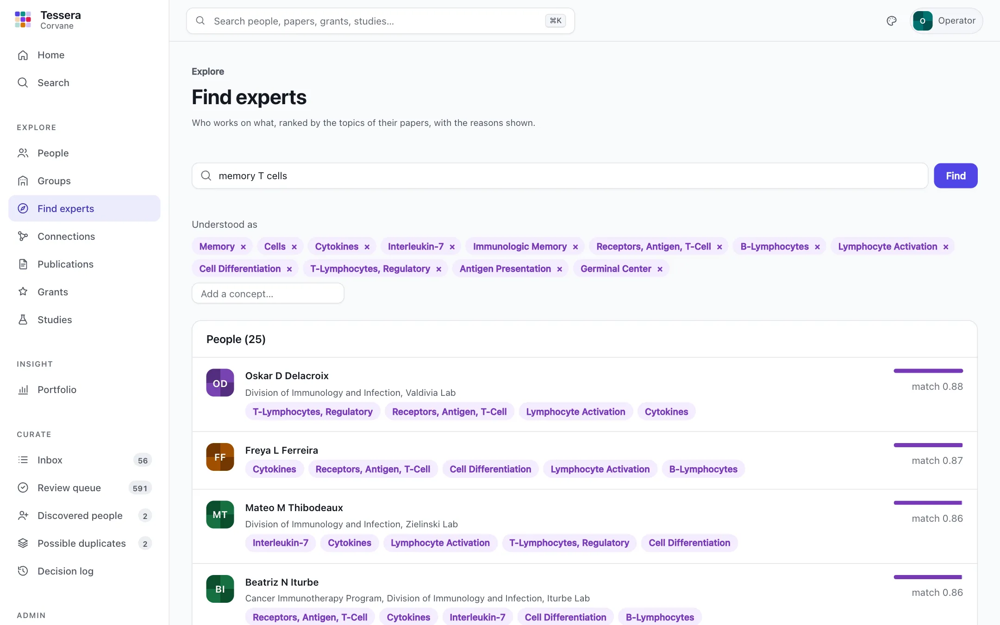
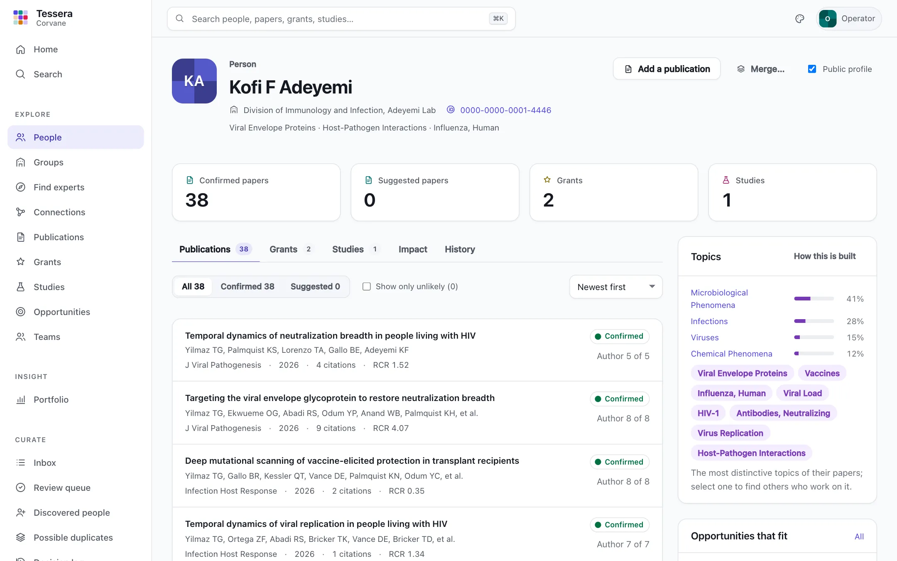
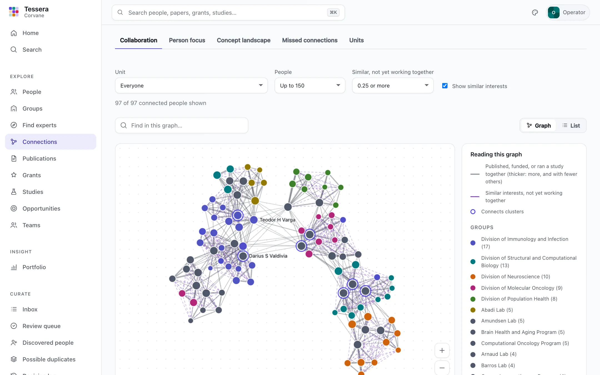
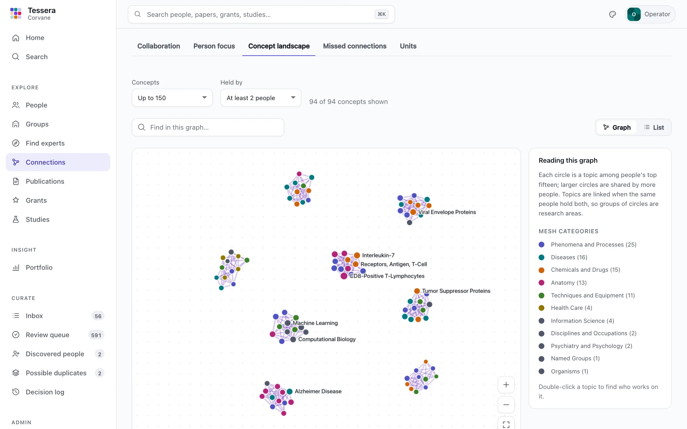
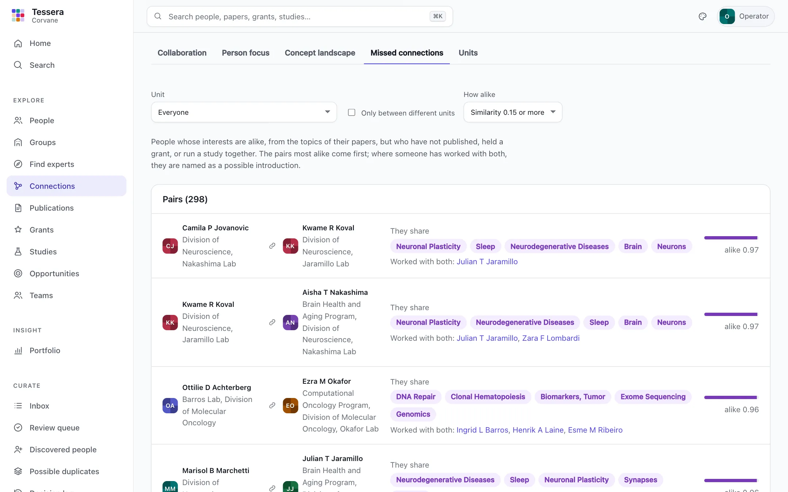
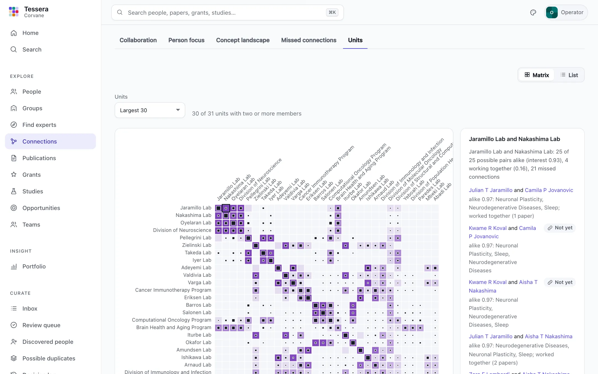

# Finding experts

Tessera describes each person's research with the MeSH headings that PubMed indexers attach to their papers. From those it answers "who works on this?", lists people with similar interests on every profile, draws who works with whom, and shows exactly what drives each person's topics. This guide explains what you see and how it is built.

## Who works on…?

Open **Find experts** in the sidebar (or press `/` and type "experts") and describe a topic in your own words: a disease, a method, a cell type, a question.

Tessera reads your words through the papers they find. It searches the organization's papers, gathers the MeSH headings those papers share, and turns them into a small set of concepts. They are shown above the results as **Understood as**:

- Select **×** on a concept to drop it, if the search drifted somewhere you did not mean.
- Type in **Add a concept** to choose a heading by name, for example "Neoplasms", and add it.
- Select a concept on any result, or on a profile, to start a new search from that concept alone.

People are ranked by how well their topics match those concepts, and each result lists the concepts that matched, so you can see why they are there. The bar is relative to the first result; it is not a grade.

Reading words through papers matters because MeSH uses its own names. A search for "cancer" finds papers indexed under "Neoplasms", so it finds the people who work on them, even though the two words never meet.



## Topics on a profile

Each profile's **Topics** card lists the person's most distinctive concepts. **How this is built** opens the full list, with, for each concept:

- its weight, relative to their strongest concept;
- how many of their papers carry it, and how many of those are confirmed;
- **from keywords**, when the concept comes only from authors' keywords on papers that have no MeSH headings yet.

A concept counts for more when it is a major topic of the paper, when the person is first or last author, and when the paper is recent: weight halves every five years. Concepts that many people in the organization share count for less, so the list shows what sets this person apart rather than what everyone has in common. Headings that describe the study rather than its subject, such as "Humans", "Female", or "Mice", are left out, as are laboratory tools such as "Green Fluorescent Proteins".

Profiles use confirmed papers and, at half weight, strong suggestions that nobody has confirmed yet, so they are useful before curation catches up. Weaker suggestions never count. To use confirmed papers only, set `likely_weight = 0` in [`[discovery]`](configuration.md#discovery).



## Similar people

The **Similar people** card on a profile lists the people whose topics overlap most, with the concepts they share. Pairs are worked out when profiles are built, not when you look, so the list is instant.

Similarity reflects the topics of people's papers. It says nothing about the quality of anyone's work or whether they are available to collaborate.

## Connections

**Connections**, in the sidebar, draws three pictures of the organization and lists two kinds of opportunity. Each picture has a **List** view with the same people, topics, and relationships as sortable tables, for keyboard and screen-reader use, or for copying.

| View | Shows | Use it to see |
|---|---|---|
| **Collaboration** | People. A solid line means they share papers, grants, or studies; it is thicker the more they share and the fewer others share it. A dashed line means similar interests without any shared work | Who works together, and who might |
| **Person focus** | One person, their top topics, and the people who share those topics, gathered around them | Who shares someone's interests, and around what |
| **Concept landscape** | Topics, linked when the same people hold both; clusters are research areas | What the organization works on, and how the areas connect |

In the graph, hover over anyone to fade everything but them and their connections, and select them to see the details beside the graph: who they worked with (papers, grants, studies, and years) and who shares their interests. Double-click a person, or choose **Focus on them**, to put them at the centre; the trail above the graph steps back. Double-click a topic to find experts on it. Drag a node to pin it in place, scroll or use the buttons to zoom, and type in **Find in this graph** to highlight people or topics by name (Enter flies to the first).

**Collaboration** shows at most 150 people by default, those with the most collaboration; the controls change the number, set how similar two people must be for a dashed line, filter by unit, or hide similarity. Every choice is in the address, so a view can be shared as a link. Each profile's **Similar people** card links to that person's focus view, and says of each similar person whether the two have worked together.

People are coloured by unit when the view spans several units, and otherwise by **group**: people who work with one another more than with others, found from the network itself and named by the topics their members share most distinctively. A ring marks someone who **connects groups**: they lie on many of the shortest paths between others and work with people in more than one group. The panel beside the graph lists them by name, with the groups they work with; it is a role in the network, not a ranking.





### Missed connections

**Missed connections** lists pairs of current members whose interests are alike but who have never published, held a grant, or run a study together, most alike first. Each pair shows the topics they share, and, when someone has worked with both, that person, who might introduce them. Limit the list to one unit, or to pairs in different units, and choose how alike they must be.



### Units

**Units** compares every pair of units (the 30 largest with at least two members, by default). In each cell, the shade shows how alike the two units' members are, and the inner square how much they work together, both per possible pair of people, so large and small units compare fairly. A strong shade with a small square marks units that share interests but rarely work together. Select a cell, or move with the arrow keys and press Enter, to see the people behind it, with what they share and whether they have worked together. The **List** view has every pair of units as a sortable table.



## Keeping it current

`tessera sync` rebuilds profiles, similar people, and the graphs at the end of every run. To rebuild them alone, for example after many curation decisions or a change to `[discovery]`:

```bash
tessera build discovery
```

Until profiles have been built once, **Find experts** says so instead of showing results.
