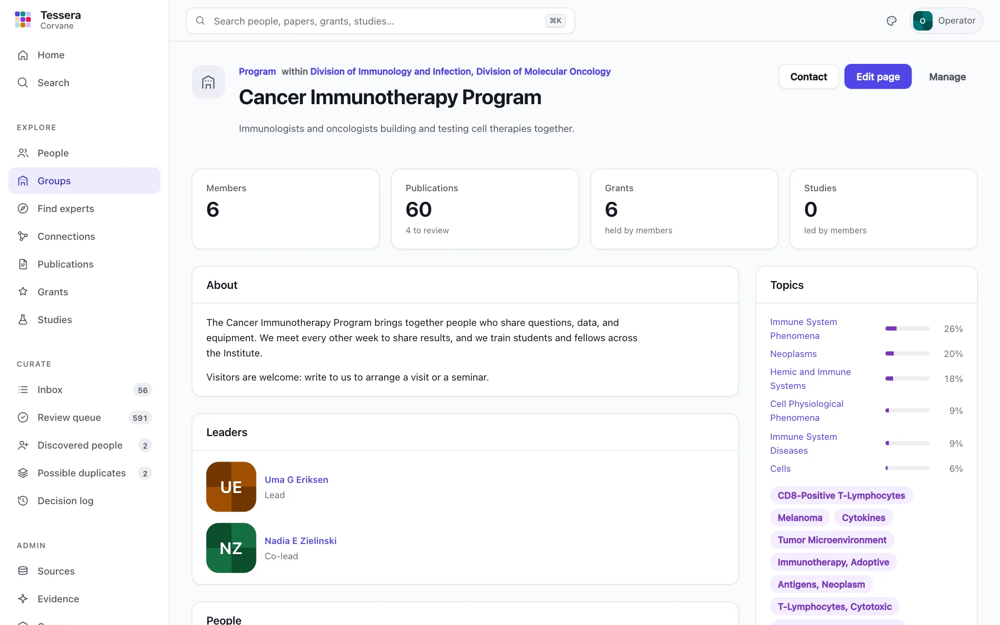
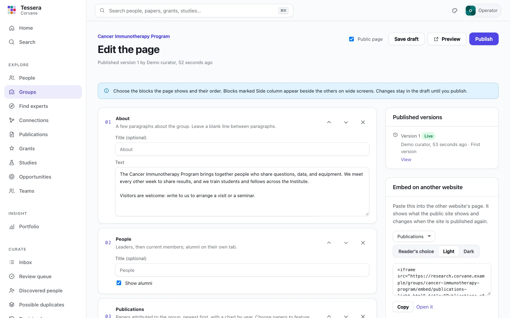
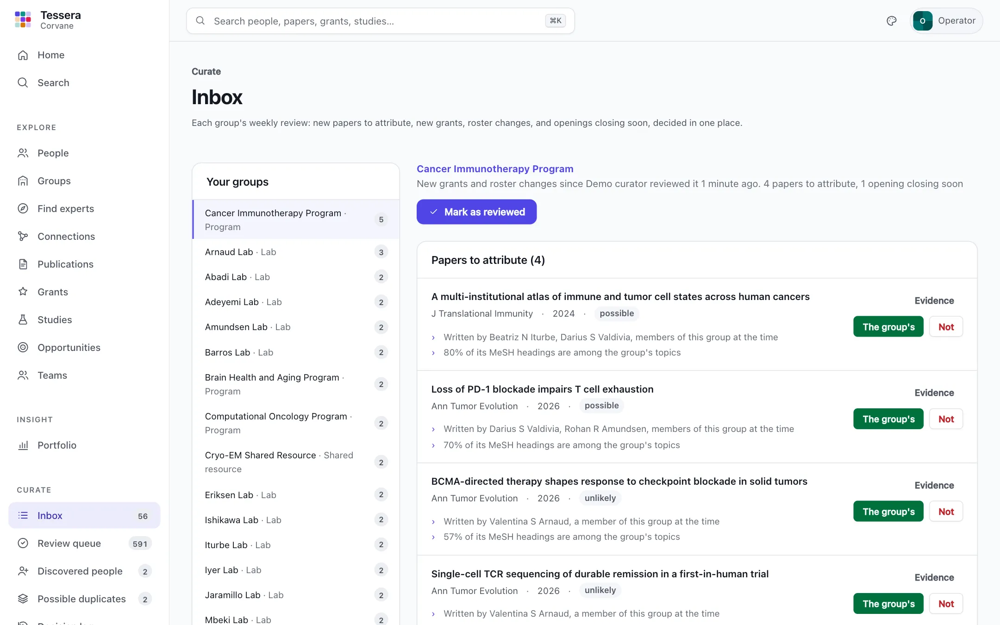
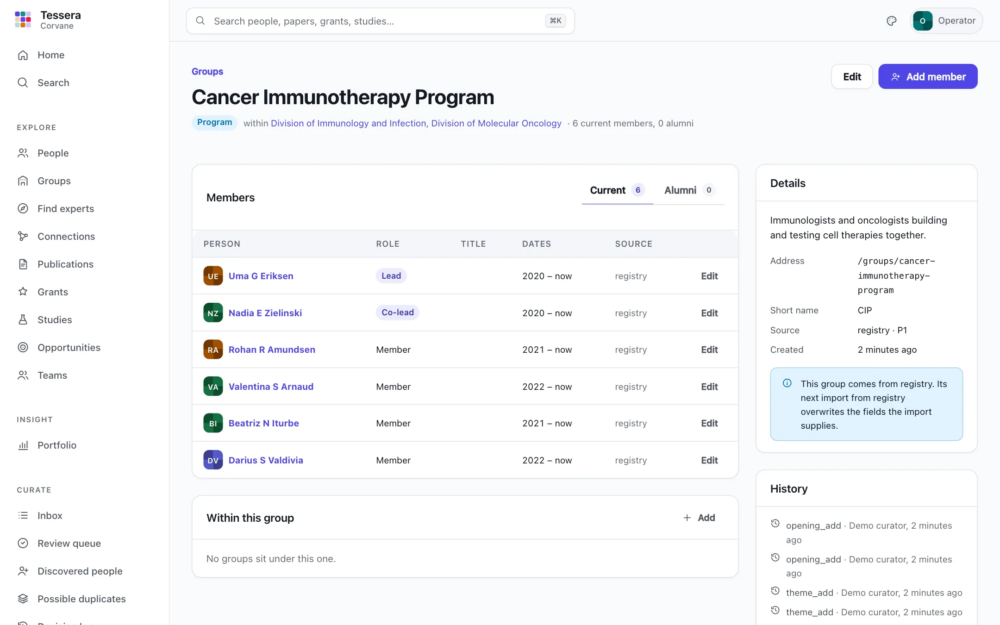

# Groups

Groups are how your organization is arranged: divisions, departments, programs, centers, shared resources, labs, and any other kind you name. Each group has people, with their roles and the dates they joined and left. A group can sit under several others; for example, a program can span two divisions.

You can curate groups by hand in the app, through the API, or from a file. Each group and membership records where it came from and the identifier it has there, so an export from your HR or organization system can supply groups later without creating duplicates.

## Kinds, roles, and what you call them

The `[vocabulary]` section of the configuration names the kinds of group you offer, the roles people hold in them, and what the app calls a group:

```toml
[vocabulary]
group = "Group"
groups = "Groups"
leader_roles = ["lead", "co_lead"]   # listed as a group's leaders
default_role = "member"              # for memberships that name no role
attributable_kinds = ["program", "lab"]  # kinds whose papers are suggested as their own

[vocabulary.kinds]
division = "Division"
program = "Program"
lab = "Lab"

[vocabulary.roles]
lead = "Lead"
member = "Member"
trainee = "Trainee"
```

Groups and memberships store the **key** (`lab`, `trainee`), and the app shows the **label**. You can rename a label at any time, but keep its key. See [Configuration](configuration.md#vocabulary) for the defaults.

## Group pages

Every group has a page of its own at `/groups/<address>`, and **Groups** in the menu lists them all by kind. A group's page shows:

- **What it does**, its kind, the groups it sits within, and its website and contact address.
- **Its leaders** (the roles in `leader_roles`) and **its people**, with their roles, titles, and dates. **Alumni** lists the people whose memberships have ended.
- **Publications attributed to it**, with a chart by year. A paper is the group's only once someone decides it is (see below).
- **Grants** held by its current members, and **studies** they lead.
- **Topics** and broader research areas: what its current members work on, from their papers' MeSH headings.
- **Writes most with**: the labs, programs, and other groups whose people write papers with this group's people.
- The groups **within** it.

Anyone who can sign in can read group pages. Admins see **Manage**, which opens the group in Admin → Groups.



## Which papers are the group's

A lab's members write papers that are not the lab's: a principal investigator collaborates with other labs, and a postdoc publishes work from a previous position. So Tessera does not count every member's paper as the group's. Instead, each sync suggests papers for each lab, program, center, shared resource, and team (the kinds in `attributable_kinds`), with the evidence:

| Evidence | Weight |
|---|---|
| Written by one member while they belonged | 0.30 |
| Written by two or more members | 0.55 |
| A leader of the group is the last author | +0.15 |
| A member's affiliation on the paper names the group | +0.30 |
| The paper acknowledges a grant a member holds | +0.15 |
| Most of its MeSH headings are among the group's topics | +0.10 |

A leader's authorship alone is weak evidence. **Every attribution is decided by a person**: the group's managers or curators, or an admin, choose **The group's** or **Not** under **Publications → To review** on the group's page. The score only orders the suggestions, and decisions stand through later syncs. Run `tessera groups attribute` to refresh suggestions without a full sync.

## Managers

A **manager** is someone from the group, such as a lab manager or a program coordinator, who keeps its page. A manager's role is limited to one group, and optionally to the groups below it:

```
uv run tessera users add wren --name "Wren Castellan" --role "manager=group:cancer-immunotherapy-program"
uv run tessera users add ines --role "manager=group:division-of-neuroscience+below"
```

or, in **Admin → Accounts**, choose **Manager** and the group, and tick **and the groups below it** if they should keep those pages too. Managers can:

- edit, preview, and publish their group's page, and restore any earlier version;
- decide which suggested papers are the group's;
- add themes and projects, and post openings;
- review the group's weekly inbox.

They cannot change memberships, other groups, or decisions about people; those stay with admins and curators. Curators limited to a group can do everything a manager of that group can.

## The group's page

A group's page is made of **blocks**, chosen and arranged by its managers (or a curator or admin) with **Edit page** on the group's page. Nothing on a page is code: each block is a few settings, checked when saved.

| Block | Shows |
|---|---|
| About | Paragraphs of text about the group |
| People | Leaders, then current members, with alumni on their own tab (which can be hidden) |
| Publications | Papers attributed to the group, newest first, with a chart by year; up to 20 chosen papers can be featured above them |
| Grants, Studies | Members' grants and studies |
| Topics | What current members work on, with broader research areas |
| Writes most with | The labs and programs the group writes papers with |
| Themes and projects, Openings | The group's themes and projects, and its open positions |
| Contact | The group's contact address and website, with an optional note |
| News | Short dated items, each with an optional link |
| Summary | The group's approved plain-language summary; offered only while [the assistant](assistant.md#plain-language-summaries) is on |

About and News can appear more than once; the others once each. Topics, Writes most with, and Contact sit beside the others on wide screens. A group whose page has never been published shows the standard arrangement of all of them.



Changes go into a **draft**. **Preview** shows the draft as the page will look. **Publish** makes it the page everyone sees, as a new numbered version with an optional note. **Published versions** lists every version with who published it and when; **View** opens any of them, and **Restore** publishes an old one again as a new version, so nothing is ever lost. **Discard draft** throws away unpublished changes. The group's history records every save, publication, and restore.

## Themes and projects

A group can describe what it works on in its own words: **themes** (long-lived questions) and **projects** (pieces of work with an end). Each has a name and a summary, and links to the people, grants, publications, and studies behind it, chosen from the group's own. Add them with **Add** in the page's Themes and projects block; archive one to take it off the page.

## Openings

A group can post **openings**: jobs, training, and other opportunities, each with a description, a link to apply, a contact address, and a closing date. An opening leaves the page by itself after its closing date, so nobody has to remember to take it down. **Close now** takes it down early; changing its date extends it.

## The inbox

**Inbox** (in the menu, for managers and curators) gathers each group's weekly review in one place:

- **Papers to attribute:** suggestions waiting for a decision, with their evidence. **The group's** and **Not** decide one; **Accept strong** decides all the strong ones at once.
- **New grants:** grants the group's current members gained since the inbox was last reviewed.
- **Roster changes:** people who joined, left, or changed role since then, by import or by hand.
- **Openings closing soon:** open openings that close within two weeks, with **Extend 30 days** and **Close now**.



**Mark as reviewed** starts a new week: new grants and roster changes count from then on. Papers and openings stay until they are decided. A group never reviewed counts the last week. The menu shows how many items are waiting.

Once a week, `tessera digest send` emails everyone with pending work a summary of it, when a mail server is configured; see [Running Tessera](operations.md#keeping-data-fresh).

## Curating groups in the app

**Admin → Groups** lists every group with its kind, the groups it sits within, its current members and alumni, and where it came from. Filter by kind or find a group by name or code. Archived groups are hidden unless you ask for them.

Open a group to see its members. **Current** lists the people who belong now, leaders first; **Alumni** lists the people whose memberships have ended. From a group's page you can:

- **Add member:** find a person in the directory, then choose their role, an optional title, and the dates. Dates can be as precise as you know them: `2015`, `2015-07`, or `2015-07-01`. Leave **Until** empty while the membership is current.
- **Edit** a membership to change its role, title, or dates. To record that someone left, set **Until**: they move to Alumni and stay there.
- **Remove** a membership only if it was a mistake. It disappears from the group, and later imports will not bring it back.
- **Edit** the group: its name, kind, short name, code, description, website, contact address, page address, and the groups it sits within. A group can sit within any number of others, but never within a group inside itself.
- **Archive** a group that no longer exists. Its memberships and history stay, and you can restore it at any time.
- **Merge** a group into another: its members, the groups within it, its place under other groups, and curator roles limited to it all move to the group you choose. Where the same person holds the same role in both, the dates widen to cover both. The merged group's address leads to the group that remains. A merge cannot be undone from the app.

Every change, by hand or by import, is listed in the group's **History** with who made it and when.



A group's **address** (`/groups/okafor-lab`) is made from its name when it is created and does not change when the group is renamed, so links to it keep working. You can change it on purpose in the edit form.

## Importing groups from a file

```
uv run tessera groups import groups.csv --source hr
uv run tessera groups import memberships.csv --source hr
```

`--source` names where the file comes from. It can be any short name, such as `hr` or `registry`, but use the same name every time, because each row's identifier is unique only within its source. Importing the same source again updates the groups and memberships it made earlier.

### Groups

A CSV file with a `name` column is a list of groups:

| Column | Required | Meaning |
|---|---|---|
| `id` | recommended | The source's own identifier for the group |
| `name` | yes | The group's name |
| `kind` | no | A key from `[vocabulary.kinds]`; rows with any other kind are skipped |
| `parents` | no | The groups it sits within, separated by `;`: their identifiers in this source, codes, or addresses |
| `code` | no | Your organization's own code for the group |
| `short_name` | no | An abbreviation |
| `description` | no | What the group does |
| `email`, `website` | no | A contact address and a website for its page |
| `status` | no | `active` or `archived` |
| `slug` | no | The address, used only when the group is created |

```csv
id,name,kind,parents
D10,Division of Neuroscience,division,
P20,Memory and Aging Program,program,D10;D30
L31,Sleep and Memory Lab,lab,P20
```

### Memberships

A CSV file with a `group` column is a list of memberships:

| Column | Required | Meaning |
|---|---|---|
| `group` | yes | The group's identifier in this source, its code, or its address |
| `person`, `orcid`, `email`, or `local_id` | one of them | Who the membership is for. People must already be in the directory: the roster adds people |
| `role` | no | A key from `[vocabulary.roles]`; the default role if empty |
| `title` | no | The person's title |
| `start`, `end` | no | `2015`, `2015-07`, or `2015-07-01` |
| `id` | recommended | The source's identifier for the membership, so a change of role updates the same membership |

### JSON

A JSON file holds both: `{"groups": [...], "memberships": [...]}`, with the same names as keys, and `parents` as a list.

### What an import changes

- The source is in charge of what it supplies. An import overwrites the fields its rows give, and replaces the parent links it made earlier. Links you added by hand stay.
- A row without an identifier matches a group by code, then by name. A group made by hand is **adopted** by the first import whose row matches it and carries an identifier: from then on it belongs to that source.
- A group merged by hand is still found: an import that names a merged group's identifier updates the group it was merged into.
- A membership you removed stays removed.
- `--complete` says the file is the source's whole list. Groups from this source that the file no longer lists are archived, and current memberships from this source that it no longer lists end today, so their people become alumni.
- `--dry-run` reports what would change and changes nothing.

Rows that cannot be imported are listed with the reason, and the rest are imported. The command exits with status 2 when it skips rows.

### The roster is one way in

The roster import (`tessera people import`) adds people, and the groups and memberships on its rows. A roster row can now give a group's kind (`kind`) and the person's role (`role`) as well as the group's name and code. Groups and memberships from the roster are recorded as coming from `roster`, so importing the roster again updates them.

## Through the API

Admins can do all of this through the API: `POST /api/v1/groups` creates a group, `POST /api/v1/groups/{group}` changes, nests, archives, or restores one, `POST /api/v1/groups/{group}/merge` merges it, and `/api/v1/groups/{group}/members` adds, changes, ends, and removes memberships. `POST /api/v1/groups/import?source=hr` takes the same rows as the JSON file, with `complete` and `dry_run`, so a scheduled job can feed groups from another system. Anyone signed in can read groups, members, and history. See [The API](api.md).

## Curator scopes

A curator can be limited to the people of one group (Admin → Accounts). The scope includes every group beneath it, through any of its parents, and only people whose memberships are current.

## Showing a group on its own website

A public group's publications, people, openings, and news can be embedded in its own website, and kept current by every publication of the public site: see [Embedding group content](public-site.md#embedding-group-content-in-another-website). Managers find the code in **Edit page → Embed on another website**.
