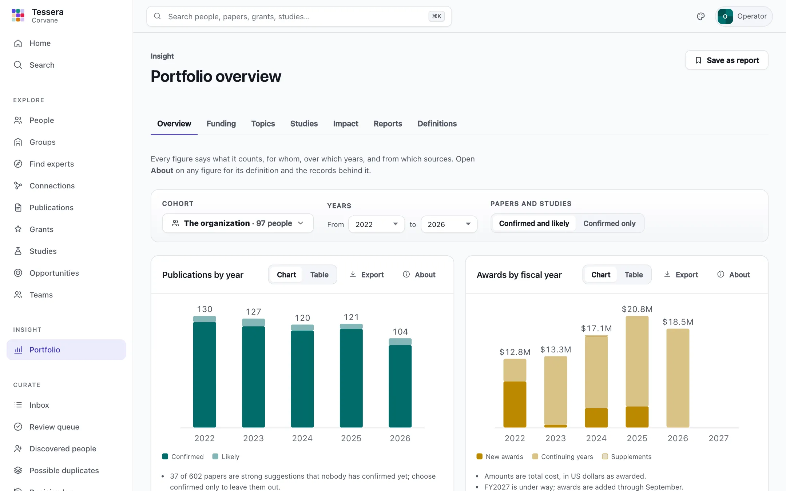
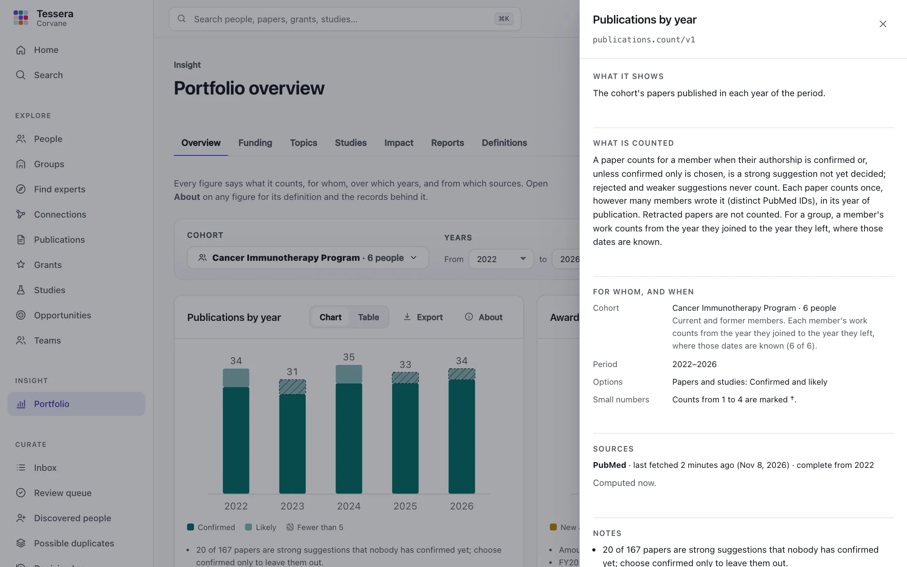
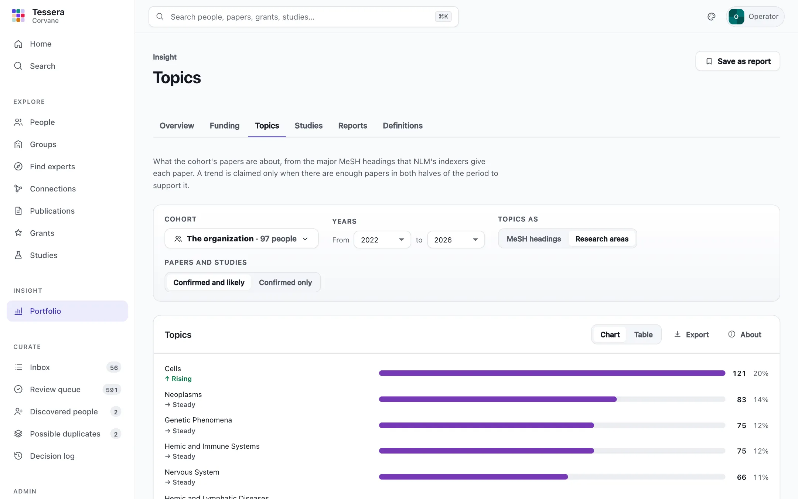
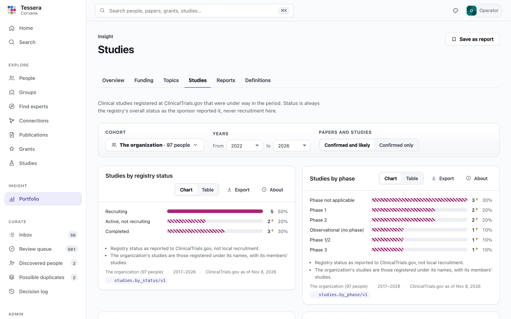
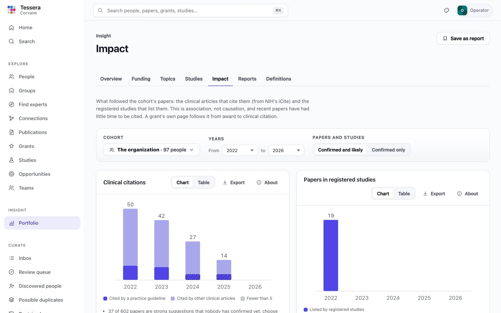
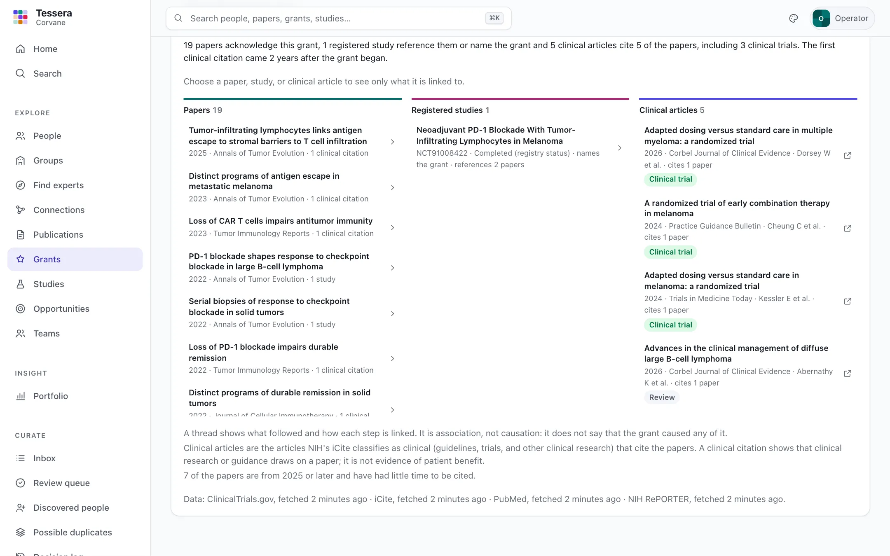
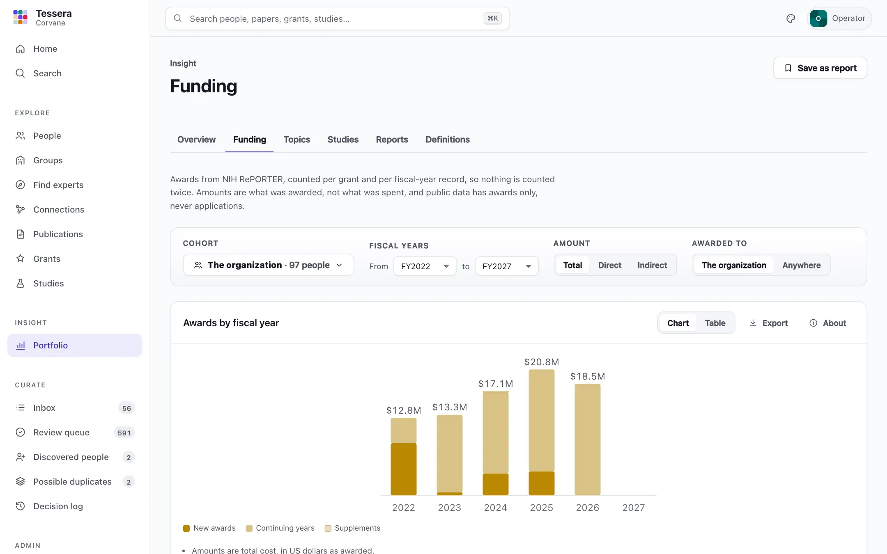
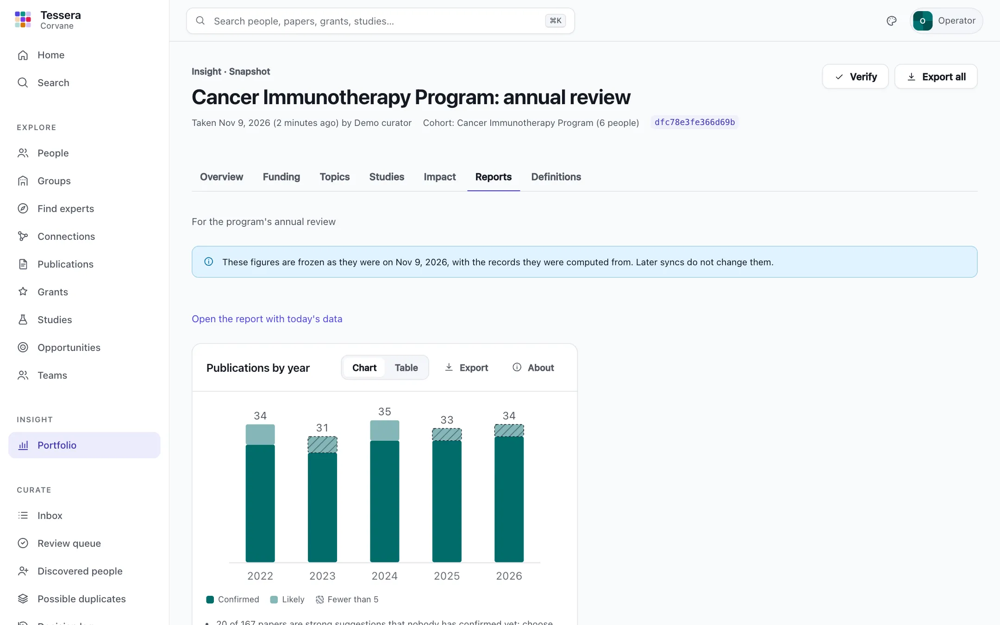

# Insight

**Insight** shows what the organization, a division, a program, or a lab publishes, is funded for, and runs as studies, over the years you choose. It is built for people who have to stand behind a number. Every figure says exactly what it counts, for whom, over which years, and from which sources, and the records behind it are one click away.

Open it from **Insight → Portfolio** in the menu.

## Reading a figure

Every figure is a **metric** over a **cohort** and a **period**:

- the **metric** says what is counted, and how (see [Definitions](#definitions));
- the **cohort** says whose work counts (see [Cohorts](#cohorts));
- the **period** is a span of years: calendar years for papers and studies, and the funder's fiscal years for grants.

Under each figure, one line names the cohort and its size, the period, when each source was last fetched, and the metric with its version, such as `publications.count/v1`. **About** opens the full account:

- **What it shows** and **What is counted**: the metric's definition and its counting rule, word for word;
- **For whom, and when**: the cohort with its size and how its members' work is counted, the period, and the options chosen;
- **Sources**: each source, when it was last fetched, and the first year its records are complete;
- **Notes** about this figure in particular, such as how many papers are strong suggestions not yet confirmed;
- **Keep in mind**: what the source cannot see;
- **Behind the number**: the records counted, each with the members it counts for and the links (with their identifiers) that put it there.

**Chart** and **Table** switch between the picture and the numbers.

### Confirmed and likely

A paper counts for a member when their authorship is **confirmed**, or when it is a **strong suggestion** nobody has decided yet: the same papers that count on profiles. Rejected and weaker suggestions never count. Figures show the two apart (confirmed in solid, likely in a lighter shade) and the notes say how many are likely. Choose **Confirmed only** in the bar at the top to count decided papers alone.

### Small numbers

Counts from 1 to 4 are **small numbers**: one paper more or less changes them a lot, and they may point at a handful of people. They are hatched in charts and marked † in tables, and trends are never claimed from them. Set the threshold with `[insight] small_number` (see [Configuration](configuration.md#insight)).

### Incomplete years

The first sync collects a set number of years of history (`[sync] window_years`, five by default). Years before that are incomplete: a figure that reaches back past them dims them and says so, and the period starts at the first complete year unless you choose otherwise.

### No league tables

No figure ranks people. Figures break down by year, funder, activity, topic, phase, or group. Where a table lists groups, it is in alphabetical order until you sort it.

## Cohorts

The **Cohort** button at the top of every Insight page chooses whose work is counted:

| Cohort | Who | Written in the address as |
|---|---|---|
| The organization | Everyone in the directory, current and former | `organization` (the default) |
| A group | Its members; with **Include the groups beneath it**, theirs too | `group:<address>`, `group:<address>+below` |
| Picked people | The people listed | `people:<ID>,<ID>` |
| A search | The people a directory search finds | `search:<words>` |
| A saved cohort | Any of the above, under a name | its ID, `coh_…` |

For a group, **While members** (the default) counts each member's work from the year they joined to the year they left, where the membership's dates are known; a member with no dates counts throughout. **Current members, all their work** counts everything the group's current members have done, whenever and wherever they did it. About says which, and how many members have dates.

**Save this cohort** keeps the current cohort under a name for everyone to choose. Managers, curators, researchers, and admins can save cohorts; the account that saved one, or an admin, can rename or delete it (a report likewise). A saved cohort holds its definition, not a list of people, so a saved group follows the group's membership as it changes.

The cohort, the period, and the options are part of the page's address, so a view can be bookmarked and shared.

## Definitions

**Insight → Definitions** lists every metric with its identifier and version, definition, counting rule, unit, years, sources, options, and caveats. A metric's definition never changes in place: counting something differently makes a new version, so a saved report always says what it counted.

### Publications

| Figure | Metric | Shows |
|---|---|---|
| Publications by year | `publications.count/v1` | The cohort's papers in each year, confirmed and likely |
| Field-normalized citation | `publications.influence/v1` | How the cohort's papers are cited against papers in their own field and year: the distribution of iCite's relative citation ratio |

Each paper counts once, however many members wrote it (distinct PubMed IDs), in its year of publication. Retracted papers are not counted. PubMed covers biomedical journals; papers in venues it does not index are missing.

The **relative citation ratio** comes from NIH's iCite: 1 means a paper is cited as often as NIH-funded papers in its field and year. The figure shows how many papers fall in each band (below 0.5, 0.5 to 1, 1 to 2, 2 to 5, 5 or more). Papers from the last two calendar years are counted apart, because iCite's ratio is provisional until then. A citation ratio describes papers, not people, and Insight never ranks anyone by it.

## Topics

**Insight → Topics** shows what the cohort's papers are about, from the major MeSH headings NLM's indexers give each paper (the headings PubMed marks as a paper's main subjects).

- **Topics** (`topics.landscape/v1`): the cohort's 30 largest topics in the period, each with its papers, its share of the cohort's papers, and its trend.
- **Topics by year** (`topics.by_year/v1`): the 12 largest, with their papers in each year.

**Topics as: Research areas** rolls headings up to the tops of the MeSH branches that name what people study (diseases, anatomy, organisms, psychology, and processes), so that "Breast Neoplasms" and "Melanoma" both count toward Neoplasms; a paper counts once per area. Areas need MeSH's hierarchy (`[sources.mesh]`); without it, topics stay headings and the figure says so. The newest papers may have no headings yet: indexing usually takes some weeks, and the notes say how many papers count toward no topic.

### Trends

A trend compares a topic's share of the cohort's papers in the later half of the period's complete years with the earlier half (at most three years each; the year under way is left out, because it is not over). A topic is **rising** when its share grew by a quarter or more, **falling** when it shrank by a fifth or more, and **steady** otherwise, but only when the topic has at least `small_number` papers in each half. Otherwise it says **too few papers to tell**, and with fewer than four complete years in the period, **too few years to tell**. The notes name the years compared.

## Studies

**Insight → Studies** shows clinical studies registered at ClinicalTrials.gov that were under way at some time in the period: started by its end and not completed before it began, by the dates in the registry record. The organization's studies are every study registered under its names, with its members' studies; another cohort's are the studies a member is an official of (confirmed or, unless *confirmed only* is chosen, a strong suggestion).

| Figure | Metric | Shows |
|---|---|---|
| Studies by registry status | `studies.by_status/v1` | Not yet recruiting, recruiting, active, completed, terminated, and so on |
| Studies by phase | `studies.by_phase/v1` | Early phase 1 to phase 4, combined phases such as phase 1/2, and observational studies, which have no phase |
| Studies by sponsor class | `studies.by_sponsor/v1` | The lead sponsor's class: NIH, other federal, industry, network, academic or other |
| Studies by intervention type | `studies.by_intervention/v1` | Drug, biological, device, procedure, behavioral, and the rest; a study with several types counts in each |
| Studies by condition | `studies.by_condition/v1` | Disease areas (the tops of MeSH's disease branches), or the conditions as registered |
| Studies by start year | `studies.by_start_year/v1` | Studies that started in each year, interventional and other |

**Status is always the registry's overall status**, as the sponsor reported it to ClinicalTrials.gov. It is not the status at any one site, and never means that a study recruits at your organization. Only registered studies are counted, and no patient-level data is stored or shown.

## Impact

**Insight → Impact** shows what followed the cohort's papers. It is association, not causation: a figure says what cites or lists the papers, never that they caused it.

| Figure | Metric | Shows |
|---|---|---|
| Clinical citations | `impact.clinical_citations/v1` | The cohort's papers in each year cited by at least one clinical article, and by a practice guideline |
| Papers in registered studies | `impact.studies/v1` | The cohort's papers in each year that studies registered with ClinicalTrials.gov list among their references |

**Clinical articles** are the articles NIH's iCite classifies as clinical (guidelines, trials, and other clinical research) that cite a paper. Tessera fetches each one's PubMed record to say what kind it is: a **practice guideline** (PubMed's Practice Guideline or Guideline types, or a consensus development conference), a clinical trial, a meta-analysis or systematic review, a review, or another clinical article. A clinical citation shows that clinical research or guidance draws on a paper; it is not evidence of patient benefit, and papers from the last two years have had little time to be cited. Papers count in their year of publication, however late the citation came.

**Registry references** are the publications a study's registry record lists, as background or results. Sponsors choose what to list, and many studies list nothing, so a paper no study lists has not been shown to be unused.

### A grant's thread

Every grant's page ends with **What followed this grant**: the papers that acknowledge it (from NIH RePORTER's link table or the paper's own PubMed grant list), the registered studies that reference those papers or name the grant, and the clinical articles that cite the papers. Choose a paper, a study, or a clinical article to see only what it is linked to; **Paths to practice guidelines** shows the papers and studies that lead to a guideline. Only links that are accepted and still reported by their source are followed, so a link a curator rejected never appears. A paper's page lists the clinical articles citing it, and a person's **Impact** tab lists what followed each of their grants and their confirmed papers.

## Funding

**Insight → Funding** shows awards from NIH RePORTER (NIH and the other agencies that report to it), counted the way a sponsored-research office counts them, so that nothing is counted twice:

- **Money comes from fiscal-year records.** Each record is one award action (a new award, a renewal, a continuing year, or a supplement) and counts once, in its fiscal year. Fiscal years are the funder's: FY2026 ran from October 2025 to September 2026.
- **Subprojects are left out.** The components of multi-project awards (the projects and cores of a P01, P30, or U54) report records of their own, but the parent award's record already includes their money.
- **A grant counts once** for a cohort, however many members are on it.
- **The organization's portfolio is every award to the organization**, whether or not its investigators are in the directory. Another cohort's portfolio is the awards to the organization on which a member is an investigator, counted in the fiscal years the member was a member. **Awarded to: Anywhere** adds members' awards at other organizations, such as a grant that moved with a new arrival.
- **The amount is always named**: total cost (the default), direct costs, or indirect costs. A record that does not state the chosen amount still counts as a grant and the notes say how many.

| Figure | Metric | Shows |
|---|---|---|
| Awards by fiscal year | `funding.awarded/v1` | Money by fiscal year, split into new awards, renewals, continuing years, and supplements, with the number of grants and records |
| Awards by funding institute | `funding.by_institute/v1` | Money by the institute or agency that administers each award, with its share |
| Awards by activity code | `funding.by_activity/v1` | Money by activity code (R01, P30, K99, T32, …) with each code's mechanism |
| Awards by funding mechanism | `funding.by_mechanism/v1` | Money by mechanism: research projects, research centers, training, career awards, and the rest |
| Awards by group | `funding.by_group/v1` | Money for each group of one kind (programs, divisions, labs, …) with members in the cohort. A grant counts for every group with a member on it, so the amounts overlap; groups are listed by name |
| Grants by project end date | `funding.ending/v1` | Grants whose projects end within the next 6, 12, or 24 months, from each grant's latest record |

An ending project is not a gap in funding: projects are often renewed, extended without new money, or followed by new awards. The figure is called **Grants by project end date** for that reason.

Keep in mind what RePORTER cannot show: foundation, industry, and most other federal funding are not in it; amounts are awarded, not spent; and public data holds awards only, never applications, so success rates cannot be computed. A member who leads one project of a multi-project award is linked to the whole award.

## Reports and snapshots

A **report** is a named set of figures over one cohort and one period, for everyone who reads Insight. **Save as report** on any Insight page saves the figures on that page with the cohort, the years, and the options you chose; **Insight → Reports** lists them. Opening a report computes its figures from the data as it is now, so a report is a question you can ask again.

A **snapshot** freezes a report. **Take snapshot** on a report (or `tessera report snapshot <name>`) computes every figure once and keeps, in `snapshots/<id>/` in the data home:

- the **inputs**: every table the figures were computed from, for the cohort's people only (its members with their years, their links, and the rows read from PubMed, RePORTER, ClinicalTrials.gov, iCite, and MeSH), as Parquet files;
- the **figures**, each as it was shown, with every record it counted;
- a **manifest**: the report's definition, the cohort as it was resolved, each figure's metric, version, period, and options, the sources and when each was last fetched, the moment it was computed, and a SHA-256 digest of every input file and every figure.

A snapshot never changes: later syncs and decisions change the report, not its snapshots, and deleting a report keeps them. **Verify** (or `tessera report verify <snapshot>`) reads the frozen inputs back, computes every figure again with the same metric versions, and confirms that each comes out byte for byte the same. It reports any input that was altered, and any metric whose version has moved on since.

Managers, curators, researchers, and admins can save reports and take snapshots; whoever saved a report, or an admin, can change or delete it. Everyone who can read Insight can open them.

## Exports

Every figure has **Export**: CSV, Parquet, or JSON. An export carries its meaning with it:

- the figure's rows, and the **records** it counted with the links (and their identifiers) behind each;
- **about.json** and **README.txt**: the metric's definition, version, and counting rule, the cohort with its definition and size, the period, the options and the filters exactly as written in the address, the sources with their data timestamps, the notes, and when it was computed and exported.

CSV and Parquet come as a zip (`funding-awarded.csv`, `funding-awarded-records.csv`, `about.json`, `README.txt`); each Parquet file also carries the account in its schema metadata under `tessera`, so it travels with the data. JSON is one file. A snapshot's **Export all** (or `tessera report export <snapshot> --format csv`) puts every figure in one zip with the manifest, and says which snapshot it came from.

## The API

Every figure is at `GET /api/v1/insight/figures/<metric>` with `cohort`, `start`, `end`, and the metric's options (such as `basis=confirmed`); `records=true` adds the records counted, and `/export?format=csv` (or `parquet`, `json`) downloads it. `GET /api/v1/insight/metrics` lists the definitions, `/api/v1/insight/cohorts` saves and lists cohorts, `/api/v1/insight/reports` saves and lists reports and takes their snapshots, and `/api/v1/insight/snapshots/<id>` shows, verifies, and exports a snapshot. See [The API](api.md#what-is-available).
