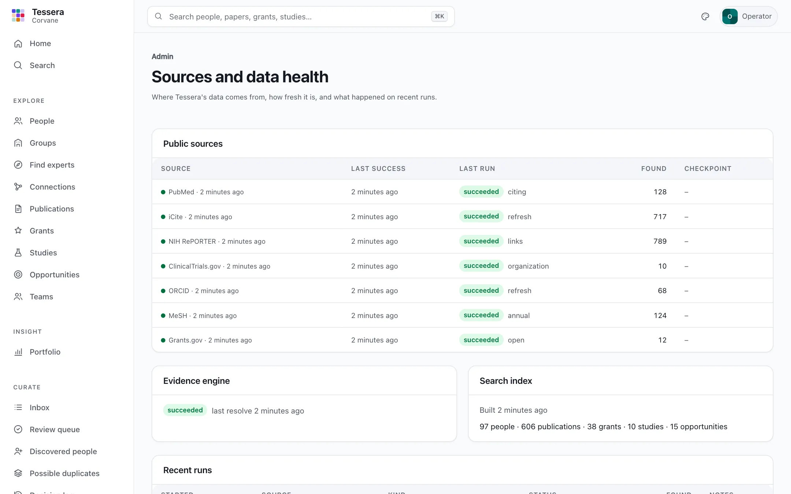
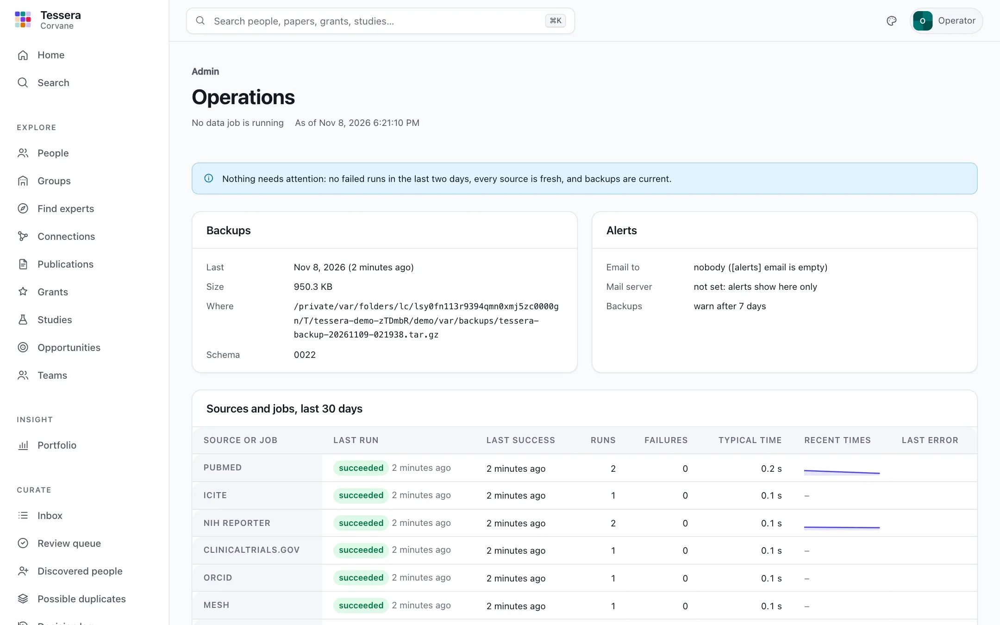

# Running Tessera

Tessera is one Python application and one folder of data. This guide covers what is in that folder, how to keep data fresh, backups, upgrades, PostgreSQL, how large a server to choose, and what to check when something goes wrong.

## The data home

Everything Tessera stores lives in the data home (`[data] home`, `./var` by default):

```text
var/
  raw/        the public sources' responses, exactly as received, one folder per run
  lake/       normalized records in Parquet files, one folder per table
  ledger.db   people, links, decisions, and run history (SQLite; absent with PostgreSQL)
  derived/    the search index and concept profiles, rebuilt from the lake and ledger
  logs/       logs, one JSON object per line
```

These parts are not equally precious:

- **The ledger is the only part that holds human work**: people, decisions, notes. Back it up.
- **The lake and raw downloads** come from public sources and can be fetched again. Keeping `raw/` lets `tessera replay` rebuild the lake without the network.
- **`derived/`** is always rebuildable with `uv run tessera build search` and `uv run tessera build discovery`.

Only one data job (a sync, ingest, resolve, or build) runs at a time per data home; a second one stops at once and says another job is running. The web app keeps working during jobs.

## Keeping data fresh

Run `uv run tessera sync` on a schedule. After the first sync it fetches only what changed, so a daily run usually takes a few minutes. Each source's expected freshness appears on the **Sources** page, which warns when a source is overdue or its last run failed.

A daily cron entry (Linux or macOS):

```cron
30 2 * * * cd /srv/tessera && /usr/local/bin/uv run tessera --quiet sync
```

A systemd timer works the same way: run `uv run tessera --quiet sync` from the folder that holds `tessera.toml`, as the user who owns the data home.

Send the weekly digest of pending work (each group's inbox, and the review queues) by email once a week, after a sync. It needs a mail server under `[mail]` (see [Configuration](configuration.md#mail)); without one, digests stay in the app's **Inbox**:

```cron
0 7 * * 1 cd /srv/tessera && /usr/local/bin/uv run tessera --quiet digest send
```

Publish the public site after each sync, so openings that closed leave it and new decisions appear (see [The public site](public-site.md)):

```cron
30 3 * * * cd /srv/tessera && /usr/local/bin/uv run tessera --quiet publish
```

`tessera digest show` prints the digests instead, and `tessera digest send --dry-run` prints the messages it would send.

`uv run tessera runs` lists recent runs with their status and counts. A run that ends *partial* fetched some but not all of its batches; the next sync retries from the last complete checkpoint, so nothing is skipped.



## Serving the app

```bash
uv run tessera serve
```

Tessera listens on `127.0.0.1:8000` by default (`[server] host` and `port`).

### How many server processes

`tessera serve` runs one process unless `[server] workers` (or `--workers`) asks for more. One is right for a laptop. On a server other people use, run about four: requests then share the processor's cores, and one slow request (the first Insight figure after the data changes, say) never holds up everyone else's. The container image and the systemd unit in `deploy/` run four, and `tessera doctor --production` warns at one.

With 20 simulated users on a 100,000-publication organization, measured with `tessera bench` on a 10-core laptop:

| | One process | Four processes |
|---|---|---|
| Users clicking every 2 to 8 seconds: slowest 5% of requests, and the slowest | 174 ms, 2.4 s | 119 ms, 1.9 s |
| Users clicking without pause: requests served a second | 24 | 73 |
| Memory of the server, under that load | 0.9 GB | 2.8 GB |

Each process takes its own memory (about 0.7 GB at 100,000 publications) and keeps its own caches; everything else they share through the ledger, including the count of failed sign-ins, so the limit on guessing holds however many there are. Branding saved in the app reaches every process within a second. More processes than cores gains nothing.

## Running it as a service

The repository's `deploy/` folder has reference files for running Tessera on a server: a container image, a compose file with PostgreSQL, systemd units, and reverse-proxy configurations. Copy them and adjust the names and paths. Before people use it, run `tessera doctor --production` (see [Checks for production](#checks-for-production)).

Whichever way it runs, Tessera listens on the machine itself, behind a reverse proxy that serves HTTPS. It needs `[server] accounts = true`; without accounts it refuses to listen anywhere but on this machine.

### On a server, with systemd

1. Create a user and a folder for Tessera, and install it there:

   ```bash
   sudo useradd --system --home-dir /srv/tessera --shell /usr/sbin/nologin tessera
   sudo mkdir -p /srv/tessera && sudo chown tessera:tessera /srv/tessera
   sudo -u tessera git clone https://github.com/robert-mcdermott/tessera.git /srv/tessera/app
   cd /srv/tessera/app && sudo -u tessera uv sync --frozen --no-dev   # --extra postgres for PostgreSQL
   ```

2. Write the configuration and the data home: `sudo -u tessera env TESSERA_CONFIG=/srv/tessera/tessera.toml /srv/tessera/app/.venv/bin/tessera init`. Set `[data] home = "/srv/tessera/var"` and `[server] accounts = true` in it, describe your organization, and add an admin (`tessera users add NAME --role admin`).
3. Put secrets (`NCBI_API_KEY`, `PGPASSWORD`, `TESSERA_OIDC_CLIENT_SECRET`, …) in `/etc/tessera/tessera.env`, one `NAME=value` a line, owned by root and readable by no one else.
4. Copy the units in `deploy/systemd/` to `/etc/systemd/system/`, then:

   ```bash
   sudo systemctl daemon-reload
   sudo systemctl enable --now tessera.service tessera-sync.timer tessera-backup.timer
   ```

| Unit | What it does |
|---|---|
| `tessera.service` | The web app, restarted if it stops |
| `tessera-sync.service`, `.timer` | A sync every night at 02:30 (a few minutes' spread); uncomment its `ExecStartPost` line to publish the public site after each |
| `tessera-backup.service`, `.timer` | A backup every night at 00:30, well before the sync, since only one data job runs at a time; old archives stay unless you uncomment the line that keeps 30 days |

Each service may write only `/srv/tessera`, has no privileges, and is limited to the system calls a service needs (`systemd-analyze security` rates the web app's exposure 1.9, "OK"). Logs go to the journal (`journalctl -u tessera`) as well as to `<data home>/logs`. To upgrade: `git pull` and `uv sync --frozen --no-dev` in `/srv/tessera/app`, `tessera db upgrade`, then `systemctl restart tessera` (see [Upgrading](#upgrading)).

### In a container

`deploy/container/Dockerfile` builds an image with uv from the lock file. It runs as an unprivileged user (uid 10001), with two volumes: `/srv/tessera/config`, which holds `tessera.toml` and branding images, and `/srv/tessera/data`, the data home. The image holds no state, so an upgrade is a new image and `tessera db upgrade`.

```bash
podman build --format docker -f deploy/container/Dockerfile -t tessera:0.7.0 .   # or docker build
```

(`--format docker` keeps the image's health check, which podman's default format drops.)

`deploy/container/compose.yaml` runs it with its ledger in PostgreSQL 16. Its first lines list the steps: a password for the database in `.env`, `tessera init` to write `config/tessera.toml`, the schema, an admin, then `docker compose up -d` and the first sync. The `config` folder must be writable by uid 10001 (`sudo chown 10001 config`, or with rootless podman `podman unshare chown 10001 config`), since **Admin → Branding** writes there. Run the sync and backups from the host's scheduler, for example `docker compose run --rm tessera tessera sync`.

### Behind a reverse proxy

`deploy/proxy/` has a `Caddyfile` (which obtains and renews certificates itself) and an `nginx.conf`. Each serves the app over HTTPS and the public site from `<data home>/public` as plain files. Whichever you use, the proxy must:

- send `X-Forwarded-Proto` and `X-Forwarded-Host`: Tessera reads them to mark its session cookie Secure, to refuse requests from other sites, and to build the single sign-on address;
- accept request bodies up to 4 MB, for branding images;
- wait up to two minutes for a response, since a first Insight figure at a million papers can take most of a minute.

Tessera sets its own security headers (a content security policy with no third-party sources, and others); the examples add HSTS.

### Health checks

| Address | Answers | For |
|---|---|---|
| `/api/v1/health/live` | `200` whenever the process answers | Container and process supervisors: restart it if this fails |
| `/api/v1/health/ready` | `200` when the ledger (at the current schema) and the lake can be read, `503` otherwise, with each check's state | Load balancers: send traffic only when it is ready |
| `/api/v1/health` | The same as `ready` | Earlier installations |

None needs signing in, and they say nothing about the organization's data.

### Checks for production

`tessera doctor --production` adds what a server other people use needs: accounts and an admin, several server processes, a contact address for the public sources, an NCBI API key, HTTPS addresses for the app and the public site, a recent sync and a recent backup, room on the disk, a search index, and not running as root. Run it after installing and after each upgrade; it exits non-zero if anything fails.

## Accounts and sign-in

Out of the box Tessera runs in *single-operator mode*: no sign-in, answering only on this machine, with every decision recorded under `[server] operator`. That suits one curator on a laptop. For several people, or for a server others reach, turn on accounts:

1. Create the first admin (you are asked for a password of at least 12 characters):

   ```bash
   uv run tessera users add ada --name "Ada Okafor" --role admin
   ```

2. Set `accounts = true` under `[server]`, and `host` to the address to listen on (for example `0.0.0.0`).
3. Put Tessera behind HTTPS, typically a reverse proxy such as nginx or Caddy that forwards to it, so that passwords and session cookies travel encrypted. Have the proxy pass the original host (`Host`, or `X-Forwarded-Host`) and `X-Forwarded-Proto: https`: Tessera refuses changes whose origin does not match the host, and marks its cookie `Secure` over HTTPS. With the proxy on the same machine, run Tessera on `127.0.0.1` and let the proxy face the network. `tessera doctor` reminds you when accounts are on and Tessera listens beyond this machine.
4. Restart `tessera serve`. Everyone now signs in; admins add the others under **Admin → Accounts**, or from the command line.

Roles add up:

| Role | May |
|---|---|
| Viewer | Read everything: people, records, evidence, search |
| Researcher | Also review the suggestions about their own profile, and keep its sections, public choices, CVs, and biosketches (the account is linked to their person; see [Profiles](profiles.md#keeping-a-profile)) |
| Manager | Keep one group's page and decide which papers are the group's (and, when granted with `+below`, the same for the groups below it). See [Groups](groups.md#managers) |
| Curator | Decide for everyone, or, when the role is limited to a group or a person, only for them (a group's scope includes the groups below it); curators for everyone also handle discovered people and duplicates |
| Admin | Everything, including accounts |

```bash
uv run tessera users add cora --name "Cora Lindqvist" --role "curator=group:Department of Medicine"
uv run tessera users add wren --name "Wren Castellan" --role "manager=group:okafor-lab"
uv run tessera users add ada.okafor --role researcher --person per_01…
uv run tessera users list
uv run tessera users reset-password cora     # signs her out everywhere
uv run tessera users disable cora            # also signs her out
uv run tessera users roles cora --role curator --role viewer
```

Sessions end after `session_idle_hours` without use (12 by default) and after `session_max_days` in any case (7). After five failed attempts for one username or address, sign-in is refused for 15 minutes. Tessera will not start with accounts on and no active admin, nor listen beyond this machine with accounts off. See [ADR-0009](../spec/decisions/0009-local-accounts-and-sessions.md) for the design.

## Single sign-on

With accounts on, people can also sign in through your organization's identity provider: Microsoft Entra ID, Okta, Google, Keycloak, or any other that speaks OpenID Connect. They sign in where they already do, with its multi-factor authentication, and leaving the organization at the provider ends their access to Tessera too. Local accounts keep working beside it, so an admin with a password can always get in.

How it works: the sign-in page shows your provider's button first, with **Sign in with a password** folded beneath it. Tessera sends the browser to the provider (the authorization-code flow with PKCE), checks the ID token that comes back (its signature against the provider's published keys, issuer, audience, expiry, and a one-time nonce), and then starts its own session as for a password. See [ADR-0011](../spec/decisions/0011-single-sign-on-with-openid-connect.md).

**At the provider,** register a web application:

- **Redirect address:** `https://<your Tessera>/api/v1/auth/sso/callback`.
- **Sign-in method:** authorization code, with PKCE (S256) required if the provider offers the choice; the client authenticated with a client secret.
- **ID tokens signed with RS256** (the usual default).
- **Claims:** `email` and `name`, and, to map roles, the app roles or groups.

**In Tessera,** add to the configuration (the example configuration has every setting, commented):

```toml
[auth.oidc]
issuer = "https://login.microsoftonline.com/<tenant ID>/v2.0"
client_id = "<application (client) ID>"
label = "Sign in with Corvane"
trust_email = true         # Entra ID marks no address verified; safe for a single-tenant app
roles_claim = "roles"      # Entra ID's app roles

[auth.oidc.roles]
"Tessera.Admin" = "admin"
"Tessera.Curator" = "curator"
"Pathology.Curator" = "curator=group:Department of Pathology"
```

Put the client secret in the environment, never in the file: `TESSERA_OIDC_CLIENT_SECRET` (or the variable `client_secret_env` names). Restart, then run `uv run tessera doctor --online`, which reads the provider's discovery document and keys.

**Accounts.** The first time someone signs in, Tessera finds their account by the provider's identifier for them; failing that, by an email address the provider marks verified (or any address, with `trust_email = true`); failing that, it creates one, named from their username at the provider, with no password. Set `create_accounts = false` to admit only people an admin has added. An account is linked to the person in the directory with the same email address, if there is exactly one (`link_people`), and then may review and keep their own profile (`researchers`).

**Roles.** With `roles_claim` and a `[auth.oidc.roles]` table, the provider's app roles or groups become Tessera roles, written as for `tessera users add --role`. They are put in place at every sign-in, so a role removed at the provider is gone at the next one. Someone with no mapped role gets `default_role` (`viewer`), or is refused if it is empty. Roles an admin gives in **Admin → Accounts** are kept as they are, and the page shows which roles came from the provider and how each account signs in. The last active admin is never removed by the provider.

Signing out of Tessera ends Tessera's session, not the provider's.

### Microsoft Entra ID

1. In the Microsoft Entra admin center, **App registrations → New registration**. Name it Tessera, choose **Accounts in this organizational directory only**, and add the redirect address as a **Web** platform.
2. **Certificates & secrets → New client secret**; put its value in `TESSERA_OIDC_CLIENT_SECRET`.
3. **App roles → Create app role** for each Tessera role you will map (value `Tessera.Curator`, and so on), then in **Enterprise applications → Tessera → Users and groups**, assign people or groups to them. Optionally, under **Properties**, require assignment, so that only those assigned can sign in.
4. The issuer is `https://login.microsoftonline.com/<directory (tenant) ID>/v2.0`; the client ID is the application (client) ID. Set `trust_email = true` and `roles_claim = "roles"`.

Prefer app roles to groups: Entra ID leaves groups out of the token for anyone in more than about 200 of them.

### Okta

Create an **OIDC, Web Application** integration with the redirect address as a sign-in redirect URI and the authorization code grant. The issuer is your authorization server, such as `https://<your domain>.okta.com/oauth2/default`. To map groups, add a `groups` claim to the ID token in the authorization server's claims (filtered to the groups Tessera needs) and set `roles_claim = "groups"`.

### Google

In the Google Cloud console, create an **OAuth client ID** of type **Web application** with the redirect address. The issuer is `https://accounts.google.com`. Google marks addresses verified; it has no roles or groups in its ID tokens, so leave `roles_claim` empty, give roles in **Admin → Accounts**, and keep `default_role = "viewer"` or set `create_accounts = false`. Limit sign-in to your organization's own Google Workspace in the consent screen's settings (an internal app).

### Keycloak

Create a client with **Client authentication** on and the **Standard flow**, the redirect address as a valid redirect URI, and **PKCE method** S256 under the client's advanced settings. The issuer is `https://<host>/realms/<realm>`. To map realm roles, add a **User Realm Role** mapper to the client with the token claim name `roles`, multivalued, added to the ID token, and set `roles_claim = "roles"`.

## Backups

`tessera backup` writes one archive of everything that cannot be made again:

```bash
uv run tessera backup                          # into <data home>/backups/
uv run tessera backup --out /mnt/backups/      # or anywhere else
uv run tessera backup --verify /mnt/backups/tessera-backup-20261108-030000.tar.gz
```

The archive (`.tar.gz`) holds the ledger as portable rows (one JSON-lines file per table, any backend), the lake (what was fetched, as Parquet), Insight report snapshots, and the configuration file, with a manifest giving each file's size and SHA-256 digest and the ledger's schema revision and row counts. `--raw` adds the raw responses from each source, which are large and can be fetched again. The search index, discovery files, and public site are left out: they are made again from the rest. A backup holds the data home's job lock, so it waits for no sync and no sync starts while it reads, and it reads the ledger in one transaction. A demo-sized installation backs up in under a second.

Schedule it after the nightly sync, and copy the archives somewhere else:

```cron
0 4 * * * cd /srv/tessera && /usr/local/bin/uv run tessera --quiet backup --out /mnt/backups/
```

`tessera doctor`, **Admin → Operations**, and [alerts](#alerts) warn when the last backup is older than `[alerts] backup_days` (seven by default).

### Restoring

```bash
uv run tessera --config new.toml restore /mnt/backups/tessera-backup-20261108-030000.tar.gz
uv run tessera --config new.toml build search
uv run tessera --config new.toml build discovery
```

`tessera restore` checks every file against the manifest first, then loads the archive into the data home and ledger that the configuration names, which must be empty: a new SQLite file, or a new PostgreSQL database. The ledger is brought to the backup's schema, every row is loaded, and the schema is upgraded to this version of Tessera, so a backup from an earlier release restores into a later one. Because the rows are portable, **a backup taken on SQLite restores into PostgreSQL** (and the other way round): that is also the way to move an installation from one to the other. A copy of the backup's configuration is put in `restored/` in the data home for reference; the configuration you pass is the one used.

## The exit export

`tessera export` writes everything Tessera knows in open formats, readable without Tessera, for leaving it or for analysis elsewhere:

```bash
uv run tessera export /mnt/exports/tessera-2026-11-08
```

The folder has every ledger table (people, names and identifiers, groups and memberships, every link with its evidence and decision, the decision logs, pages, reports, profile entries and their history, CVs and biosketches, and settings) and every lake table (the current version of each record fetched from PubMed, iCite, NIH RePORTER, ClinicalTrials.gov, ORCID, and MeSH), each as Parquet and CSV; report snapshots; `DATA-DICTIONARY.md`, describing every table and column; and a `manifest.json` with row counts and digests. Password hashes, browser sessions, and the count of recent failed sign-ins are left out. In CSV files, lists and objects are JSON text.

## Operations and alerts

**Admin → Operations** shows, for administrators:



- what needs attention now: runs that failed or partly failed in the last two days, sources that have gone stale, and a backup older than `[alerts] backup_days`;
- every source and job over the last 30 days: the last run and when it last succeeded, runs, failures, the typical time a run takes and the recent run times, and the last error;
- the sizes of the ledger, the lake (table by table), the raw responses, the search and discovery files, report snapshots, and backups kept in the data home;
- the last backup, and whether a data job is running now.

The same is at `GET /api/v1/operations`.

### Alerts

Set who hears about problems, and give Tessera a mail server (see [Configuration](configuration.md#mail)):

```toml
[alerts]
email = ["research-it@example.edu"]
backup_days = 7
```

`tessera sync` then sends one email at its end when there are issues, and `tessera alerts --send` does the same at any time (`tessera alerts` alone lists them). The same set of issues is sent once, and again after a week if it persists; `--force` sends it now. A sync never fails because an alert could not be sent.

## Upgrading

```bash
git pull
uv sync
uv run tessera db upgrade      # apply ledger migrations, if any
uv run tessera build search    # rebuild the index with the new version
uv run tessera build discovery # and concept profiles and the graph
```

`tessera doctor` and the web app's health check (`/api/v1/health`) report a ledger that needs `db upgrade`. Migrations keep every row: they are tested on SQLite and PostgreSQL with a populated ledger, upgrading and downgrading. Take a backup before upgrading anyway (`tessera backup`). The [changelog](../CHANGELOG.md) notes anything that needs more than these steps.

## PostgreSQL

The ledger (people, links, decisions, groups, profiles, accounts, and history) can live in SQLite or PostgreSQL; the lake and search index stay in the data home either way. Every test runs on both, and everything works the same on each.

**SQLite** is the default and needs nothing else: one file in the data home, backed up by `tessera backup`. It suits an organization of any size on one server; readers never wait for the writer, and Tessera writes little.

**Choose PostgreSQL** when:

- your organization already runs PostgreSQL, with its own backups, replication, and monitoring, and wants the ledger looked after with the rest;
- the database must live on a managed server separate from the one that runs Tessera;
- policy requires a database server rather than a file.

To use it:

```bash
uv sync --extra postgres
```

Then create an empty database, set `[ledger] url = "postgresql+psycopg://tessera@dbhost/tessera"` (or `TESSERA_LEDGER_URL`), and run `uv run tessera db upgrade` to create the schema. Put the password in the standard `PGPASSWORD` variable or a `.pgpass` file rather than in the URL. Tessera is tested on PostgreSQL 16.

**Moving an installation from SQLite to PostgreSQL:**

1. Stop the server and any scheduled sync, and take a backup: `uv run tessera backup`.
2. Create an empty PostgreSQL database for Tessera.
3. Copy the configuration; in the copy, set `[ledger] url` to the new database and `[data] home` to a new, empty folder. Restore into them: `uv run tessera --config new.toml restore <backup>` (see [Restoring](#restoring)).
4. Start the server with the new configuration and check **Admin → Operations**. Keep the old data home until you are satisfied.

The same steps, the other way round, move an installation back to SQLite.

## Sizing a server

What Tessera needs grows with the number of publications more than with the number of people. These figures come from `tessera bench` (see [Measuring your own server](#measuring-your-own-server)) on a laptop: a 10-core Apple M4 with 32 GB of memory and an SSD, with the ledger in SQLite. Treat them as a guide, and measure on your own server.

| | 1,000 people, 100,000 papers | 10,000 people, 1,000,000 papers |
|---|---|---|
| Ledger | 0.9 GB | 8.2 GB |
| Lake | 0.04 GB | 0.4 GB |
| Search index and other derived files | 0.3 GB | 3.0 GB |
| `raw/`, from real downloads (not measured) | about 0.8 GB | about 8 GB |
| A first sync's local work, after the download | about 2 minutes | about 45 minutes |
| A nightly sync's local work, after the download | about 2 minutes | about 36 minutes |
| Memory of one server process | 0.6 GB | 2.0 GB |
| Memory of a sync, at its peak | 4.4 GB | 16 GB |

- **Memory.** A sync runs as its own process and holds the whole organization in memory while it resolves authorship and builds concept profiles, so it decides the memory a server needs, with the server's processes beside it (four take four times the figure above): 8 GB is enough at 100,000 papers, and 32 GB at a million. Up to 512 MB of each server process's memory is Insight's cache of the inputs it has gathered.
- **Disk.** The ledger is the largest part the benchmark measures: it keeps every link between a person and a record (about 4.3 million at a million papers) with the evidence for each, about 1.4 KB a link. Simulated papers have shorter text than real ones, so a real lake and search index are larger: real papers take about 1.5 KB each in the lake, four times the simulation's. The benchmark downloads nothing, so it leaves `raw/` empty; there, every response is kept as received, compressed, at about 8 KB a paper (8 GB a million), so that `tessera replay` can rebuild the lake without the network. Allow the totals above, `raw/`, and as much again, for backups (each `tessera backup` copies the ledger) and for the next search index, which is written beside the current one before it replaces it.
- **Time.** The download is not included: it is bounded by the public sources (PubMed sends 200 records a request, so a million papers is 5,000 requests), and at a million papers the first one takes hours. A nightly sync's local work is resolving what is new and rebuilding the search index and the derived views; the app keeps working while it runs.
- **Processor.** Resolving authorship uses one core; the builds use them all.

At the largest size, some things are slower than they should be; each is recorded in the project's plans with what would fix it:

- **The nightly resolve** recomputes every suggestion, not just what changed: about 15 minutes at a million papers, and 45 seconds at 100,000.
- **An Insight figure, the first time after the data changes** (a sync or a decision), takes 7 to 21 seconds at a million papers, and about a second at 100,000. After that it is served from the cache in milliseconds.
- **A search for a common topic word**, one in a quarter of all papers, takes about half a second at a million papers (a second to search everything), and up to 2.3 seconds the first time, while its facets are counted; a search for a name takes a few hundredths of a second.
- **The review queue** counts every open suggestion on each request: about half a second with 450,000 open. It loads the next items ahead, so a curator rarely waits.

### Measuring your own server

```bash
uv run tessera bench /srv/bench --people 10000 --papers 1000000
```

This builds a simulated organization in that folder; it never touches the network, your data home, or your ledger. It runs what a first sync and a nightly sync do locally, starts the app on a free port, times its main pages one request at a time (the first request, the median, and the 95th percentile, against their budgets), and then has simulated users use it at once. It prints the results with each step's peak memory, the data's size, and the machine, and saves them as `bench-<time>.json` in the folder, so results from different servers can be compared.

**Many people at once.** 20 simulated users (`--users`) use the app for a minute each way (`--seconds`), on four server processes (`--workers`), each run with a new server whose caches are empty, as after the nightly sync. Each user asks for a mix of profiles, searches, lists, the review queue, groups, grants, and Insight figures:

- **at a realistic pace**, waiting 2 to 8 seconds between requests (faster than people read): the slowest 5% of requests should take under 300 ms, and none over 2 seconds;
- **without pause**, asking again as soon as each answer comes, several times the load real people make: this shows how many requests the server can serve a second. The slowest 5% should take under a second, and none over 5 seconds.

The report also gives the slowest requests after the first 30 seconds, once the caches the first requests fill are full. To run only this part on an organization already built: `tessera bench /srv/bench --people … --papers … --only load`.

At the largest size it needs about 15 GB of disk and two hours; the default size (1,000 people and 50,000 papers) takes a few minutes. Run it again in the same folder to time a nightly sync and the pages without building again; `--rebuild` starts over, and `--seed` makes a different organization. To measure PostgreSQL, point `[ledger] url` in the `tessera.toml` the first run leaves in the folder at an empty PostgreSQL database, then run again with `--rebuild`.

## Lake maintenance

The lake keeps earlier versions of records when sources update them. Occasionally:

```bash
uv run tessera lake status     # files and rows per table
uv run tessera lake compact    # rewrite each table to current rows only
uv run tessera lake gc         # delete superseded files older than 7 days
```

## When something goes wrong

- **`tessera doctor`** checks the configuration, the data home, the ledger schema, and the database engines Tessera relies on (SQLite full-text search and DuckDB); `tessera doctor --online` also checks that each public source can be reached.
- **`tessera runs`** and the **Sources** page show failed or partial runs with the source's error.
- **Logs** are in `<data home>/logs`. Add `-v` to any command for more detail.
- **A source changed or was down:** run `uv run tessera sync` again; completed work is not repeated.
- **Search looks out of date:** `uv run tessera build search` rebuilds it from the lake and ledger in seconds.
