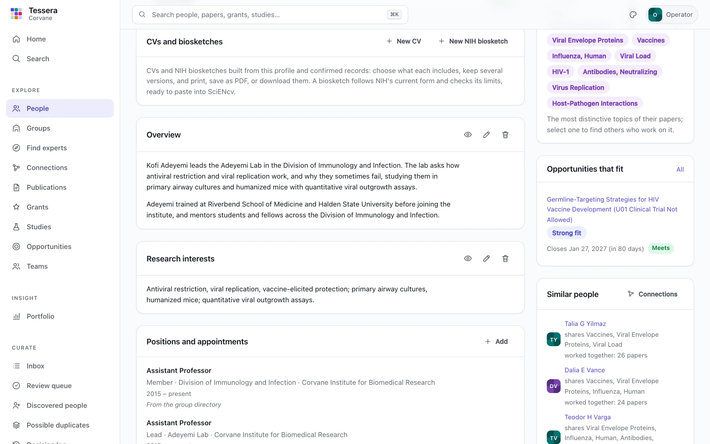
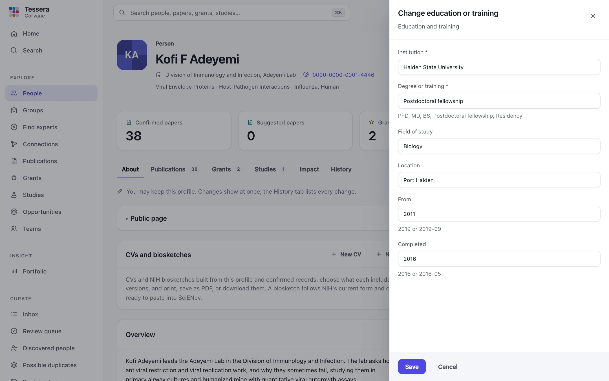
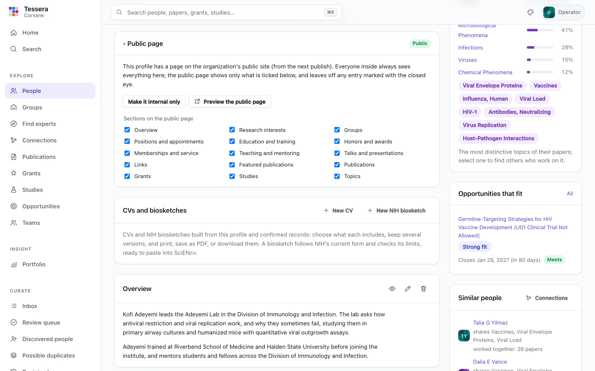
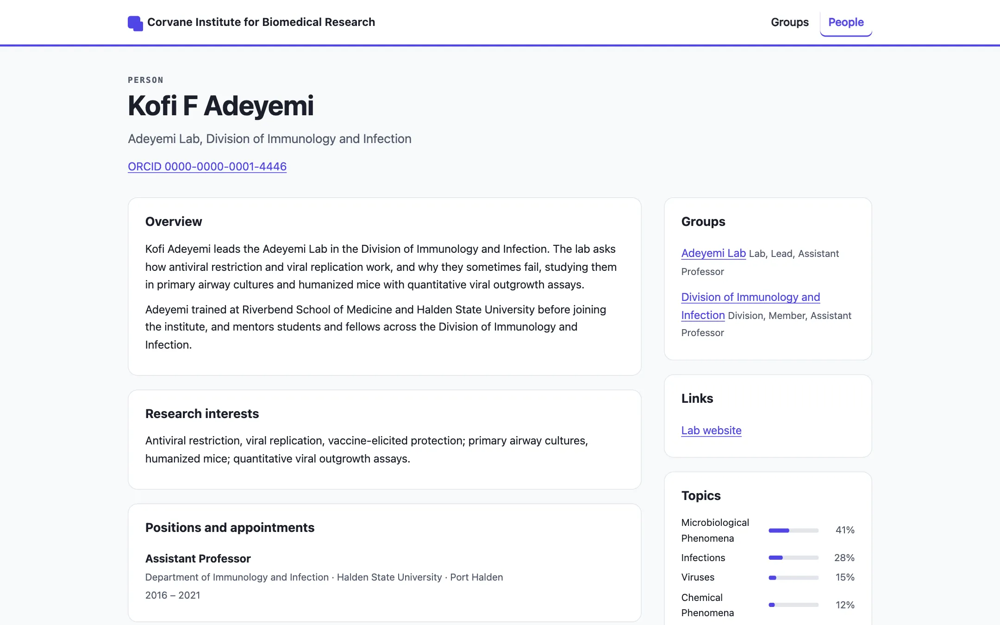
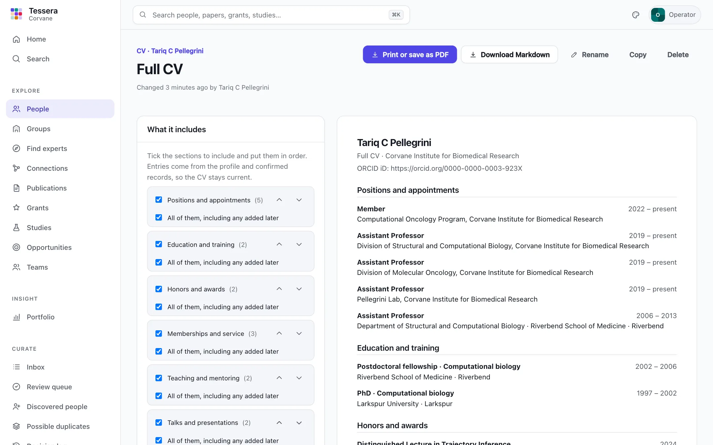
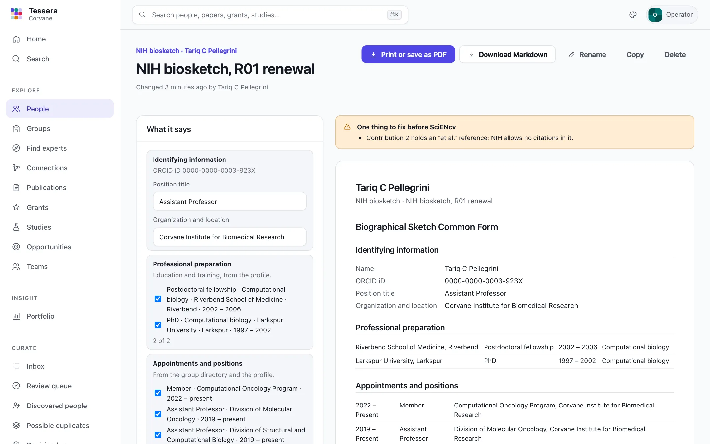

# Profiles

Everyone in the directory has a profile. Tessera builds part of it from public records: confirmed papers, grants, and studies, their groups and roles, and the topics of their work. The researcher keeps the rest: an overview, research interests, earlier positions, education, honors, service, teaching, talks, links, and the papers they want to feature. Every profile is open to everyone who can sign in, public only by the researcher's choice, and the source of their CVs and NIH biosketches.

Profiles are deliberately simple: sections and entries, edited directly, with a history of every change. There are no drafts, approvals, or review cycles, and no metric that ranks one person against another.

## The About tab

A profile opens on **About**: the overview and interests first, then positions, education, honors, service, teaching, talks, links, and featured publications. The other tabs list the person's publications, grants, studies, impact, and history, as before. People outside the directory (discovered people not yet promoted) have no About tab and open on their papers.

| Section | Each entry has |
|---|---|
| Overview | A few paragraphs about the person and their work (one, at most 5,000 characters) |
| Research interests | A line or a paragraph (one, at most 2,000 characters) |
| Positions and appointments | Title and organization; department, location, dates, and a description |
| Education and training | Institution and degree or training (PhD, MD, postdoctoral fellowship, residency); field, location, and dates |
| Honors and awards | The honor and the year; who awarded it, and a description |
| Memberships and service | Role and organization (member, reviewer, committee chair); dates |
| Teaching and mentoring | A course or a person mentored, and its kind; role, organization or program, and dates |
| Talks and presentations | Title, event, and date (a year, a month, or a day); kind (invited, keynote, and so on), location, and a link |
| Links | A label and a web address (at most 20) |
| Featured publications | One of the person's confirmed papers, and why it matters (at most 10) |

Positions from the group directory come first among positions, marked **From the group directory**; they stay where the directory keeps them. The researcher adds what Tessera cannot know, such as earlier positions elsewhere and joint or adjunct appointments, and those follow in their own order. A featured paper must be one of the person's confirmed papers; if it is later rejected, it stays on the profile for those who keep it, marked, and disappears for everyone else.

Sections with nothing in them are hidden from readers. Those who keep the profile see them under **Add to this profile**.

With [the assistant](assistant.md#plain-language-summaries) on, an approved plain-language summary sits at the top of the profile; with it off, nothing on a profile mentions it.

## Keeping a profile

A profile is kept by:

- **the person**, through the account linked to them (see [Accounts and sign-in](operations.md#accounts-and-sign-in)), whatever their role;
- a **curator** whose scope covers them, and any **admin**;
- anyone the person **names** to keep it for them.

Everyone else reads the same page without the controls. Those who keep it see **Add** on each section, and on each entry buttons to change it, move it up or down, remove it, and leave it off the public page (the eye). Entries are added and changed in a form built from the section's fields, which checks them as they are saved: required fields, dates given as a year or a year and month (a talk may give the day), an end no earlier than the start, links that are web addresses, and lengths.

Changes show at once. The **History** tab lists every one beside the curation decisions about the person: who made it, when, what it was before, and on whose behalf.

### Someone to act for them

A researcher can name an account, such as a lab manager or an assistant, to keep their profile for them. Under **Who keeps this profile**, enter the account's username. Only the person, their curators, and admins can name someone or remove them; removal takes effect at once.

Someone acting for a person may change their profile sections, their public choices, and their CVs and biosketches. Nothing else: not their authorship decisions, their identifiers, or anything else about them. Every change they make records both who made it and that it was for the person; the history shows it as, for example, "Wren Castellan (acting for them)". The profiles an account keeps for others are listed in its own menu.

Everyone sees the names of those who keep a profile; only its keepers see their usernames. Without accounts (single-operator mode) there is nobody to name, and the card is not shown.

## Public by choice

Nobody appears on the [public site](public-site.md) unless they choose to. The **Public page** card on the About tab says whether the profile is public, and those who keep it can:

- **Make it public** or **Make it internal only**; the page appears or goes at the next `tessera publish`;
- choose the **sections on the public page**: the profile's own sections, and publications, grants, studies, groups, and topics;
- leave a single entry off the public page with the eye beside it;
- **Preview the public page**, built by the same code as `tessera publish`, for this person alone.

A section added in a later version of Tessera shows on a public page unless the person leaves it off, as their own sections do when first filled in. Inside the organization, the profile always shows everything; the choices only shape the public page.

## CVs

**CVs and biosketches** on the About tab lists a person's documents. **New CV** starts one with every section but the summary; give it a name, such as "Promotion dossier" or "Visiting scholar", and keep as many versions as you need. CVs and biosketches are working documents: they are seen only by the person, those acting for them, their curators, and admins.

A CV holds only its choices, and is built from the profile and the confirmed records whenever it is shown, so it never goes stale. In the editor:

- **Tick the sections** to include, and put them in order with the up and down buttons. A CV can show a summary (the profile's overview), positions, education, honors, service, teaching, talks, publications, grants (as investigator, with the person's role), and studies (as an official).
- In each section, keep **All of them, including any added later**, or untick it and choose the entries and their order.
- **Publications** are the confirmed papers only: **All confirmed**, **Since a year**, or **Chosen ones**, numbered or not. They are cited close to the National Library of Medicine's style (authors, title, journal, year, volume and pages, DOI and PubMed ID), with the person's name in bold.

The preview beside the editor follows every change. **Print or save as PDF** prints the CV alone, without the app around it; **Download Markdown** gives the same document as text that opens in a word processor. **Copy** starts a new version from this one; **Rename** and **Delete** do what they say.

A CV that lists all confirmed papers picks up a paper as soon as it is confirmed; one that lists chosen papers does not.

## NIH biosketches

**New NIH biosketch** prepares a biosketch in NIH's current form. For applications due on or after January 25, 2026, a senior or key person's biosketch is the **Biographical Sketch Common Form** with the **NIH Biographical Sketch Supplement**, completed and certified in [SciENcv](https://www.ncbi.nlm.nih.gov/sciencv/) by the investigator ([NOT-OD-26-018](https://grants.nih.gov/grants/guide/notice-files/NOT-OD-26-018.html)). Tessera arranges the content in the form's sections, checks NIH's limits as you write, and gives each section ready to paste into SciENcv. It does not produce the certified PDF: only SciENcv does, and only the investigator can certify it.

| Part | In Tessera | NIH's limit |
|---|---|---|
| Identifying information | Name, position title, organization, and the ORCID iD from the profile's confirmed identifiers | An ORCID iD is required |
| Professional preparation | Chosen from education and training | |
| Appointments and positions | Chosen from positions, the group directory's included | |
| Products | Up to 5 closely related to the project and up to 5 other significant ones, chosen from confirmed papers or written as citations | 5 and 5 |
| Personal statement | Written in the editor | 3,500 characters, no citations |
| Honors | Chosen from honors and awards | 15 |
| Contributions to science | Written in the editor | 5, each 2,000 characters, no citations |

The editor counts characters as you type. A box above the preview lists what NIH would not accept yet, each with where it is and by how much: a statement 100 characters too long, a sixteenth honor, a product that is not one of the person's confirmed papers, no ORCID iD, or something in a narrative that looks like a citation (a PubMed or PMC ID, a DOI, an "et al." reference, or a numbered reference). Nothing is refused, so a draft can be saved while it is still too long.

**Copy for SciENcv** gives each section as plain text in SciENcv's order, with the products as citations. The print layout and **Download Markdown** follow NIH's order too. A saved biosketch records the form it was built for (`nih-2026-01`), so one built for an earlier form can be told apart if NIH changes it.

With [the assistant](assistant.md#drafting-a-biosketch) on, **Draft with the assistant** beside the personal statement and each contribution writes a first draft from confirmed papers the researcher chooses. The draft stays in a drawer until they choose **Use this draft**, and nothing is saved until they save it.

## Where an entry came from

Every entry records where it came from: entered by hand, or an import, with the source and the source's own identifier for it. An import would find its own entries again by that identifier and never touch one entered by hand, so a later feed, such as ORCID's public record or an HR system, could add to profiles without duplicating anything. This version has no import; nothing requires one.

## From the API

Profiles, public choices, delegates, CVs, and biosketches each have endpoints under `/api/v1/people/{id}/profile` and `/api/v1/people/{id}/cvs`; see [The API](api.md). A biosketch comes with its `checks` and its sections for SciENcv (`sciencv`).
