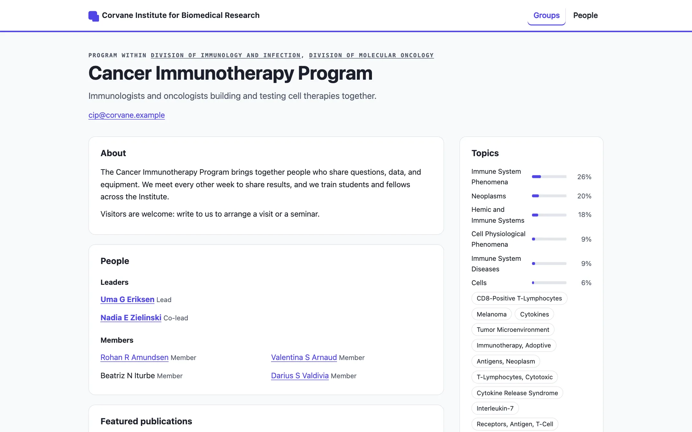
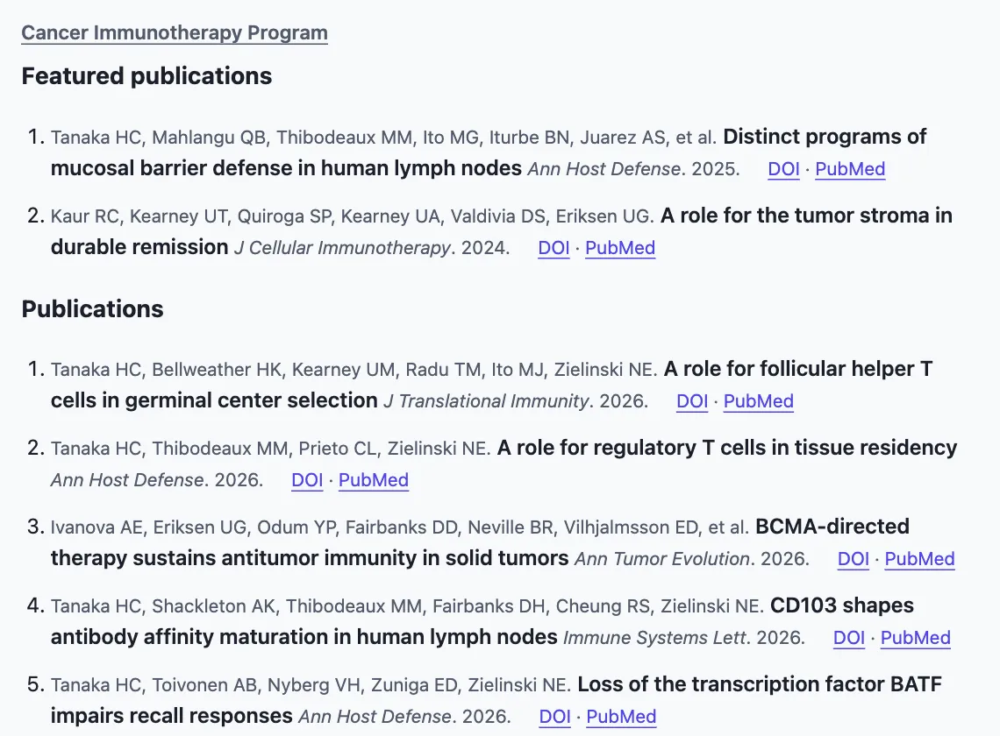

# The public site

Tessera's app is for your own people, behind your sign-in. `tessera publish` writes a separate **public site**: plain pages for the groups and people who opt in, which any web server can serve. The app itself never needs to face the internet.

```
uv run tessera publish
```

The site is written to `public/` in the data home, or wherever `[publish] out` says. It has:

- a **home page** with every published group, by kind;
- a page for every **group** that opted in, following its published blocks (see [Groups](groups.md#the-groups-page)): what it does, its leaders and people, its publications, grants, studies, themes and projects, openings, news, topics, and contact;
- a page for every **person** who opted in: their groups and roles, ORCID iD, research areas and topics, publications, grants, and studies;
- indexes of groups and people, a `404.html`, `robots.txt`, and, when `base_url` is set, a `sitemap.xml`;
- for every public group, pages to [embed in another website](#embedding-group-content-in-another-website) and a JSON feed.



## Who appears

Nobody appears unless they opt in.

- A **group** opts in with **Public page** in its page editor (its managers or curators), or `tessera groups public <address>`.
- A **person** opts in with **Public profile** on their profile (they themselves, if their account is linked to it, or a curator), or `tessera people public <ID>`.

`--off` on either command takes pages away at the next publication. A group's page lists its people by name and role; only people who opted in link to a profile.

## What the site shows, and what it never shows

The site is built from an **allowlist**: every field on it is chosen by name, so nothing new reaches it by accident.

| Shown | Never shown |
|---|---|
| Names, roles, titles, and dates of membership | Email addresses of people (a group's own contact address is shown) |
| Confirmed publications, as citations: authors, title, journal, year, with links to the DOI and PubMed | Abstracts, suggestions, scores, evidence, and decisions |
| Grants by title, number, institute, and years; studies by title, NCT number, phase, and status | Anything from the internal app: IDs, accounts, history, the review queue |
| Topics and research areas, with credit to MeSH | Unconfirmed papers: only papers someone confirmed are published |
| A group's themes, projects, open openings, news, and contact | Openings that have closed |

`tessera publish` notes public profiles that have no confirmed papers yet: confirm their papers in the app, and they appear at the next publication.

## Checked before it is published

The site is built in a fresh folder and checked before it replaces the published one. Every page must declare its language, have one title and one main heading with headings in order, have its landmarks (header, labelled navigation, main content, footer), give every link and image a text alternative, carry no scripts (other than structured data), no inline styles, and no event handlers, and link only to pages that exist. The site's colors must meet WCAG 2.2 level AA in both light and dark mode. If anything fails, the command lists the problems, exits with status 1, and leaves the published site as it was. `tessera publish --check` builds and checks without writing anything.

Pages work without JavaScript, follow the reader's light or dark preference, carry page descriptions, Open Graph tags, and schema.org structured data for people and organizations, and print cleanly.

## Settings

```toml
[publish]
out = "/srv/www/research"                     # where to write the site (default: <data home>/public)
base_url = "https://research.example.edu"     # where it is served: for the sitemap and canonical links
title = "Research at Example University"      # the site's title (default: the organization's name)
intro = "Who we are and what we work on."     # a sentence or two for the home page
```

The site takes its colors from your branding; see [Configuration](configuration.md#branding).

## Embedding group content in another website

A group's publications, people, openings, and news can appear on its own website, kept current by Tessera. For every public group, `tessera publish` also writes small pages made to be framed, and a feed:

| File | What it is |
|---|---|
| `groups/<address>/embed/publications.html` | The group's publications (featured first), as on its page |
| `groups/<address>/embed/people.html` | Its leaders and members |
| `groups/<address>/embed/openings.html` | Its open openings, which drop off when they close |
| `groups/<address>/embed/news.html` | Its news |
| `groups/<address>/feed.json` | A [JSON Feed](https://jsonfeed.org/version/1.1) of its news, openings, and confirmed publications, for sites that show content themselves |



Each embed comes in three versions: `publications.html` follows the reader's light or dark preference, and `publications-light.html` and `publications-dark.html` stay light or dark to match the page around them. Embeds have no site header, carry no scripts, open links in the page around them, show only what the group's public page shows, and link back to it. They always exist for a public group, even with nothing to show yet, so the code on another site keeps working; a group that is not public has none, and search engines are asked not to index them on their own.

The group's managers find the code in **Edit page → Embed on another website**, once `[publish] base_url` says where the site is served:

```html
<iframe src="https://research.example.edu/groups/okafor-lab/embed/publications-light.html"
        title="Publications of the Okafor Lab" width="100%" height="600" style="border:0"
        loading="lazy"></iframe>
```

The site serving the embeds must allow other sites to frame them: if your web server sends `X-Frame-Options` or a `frame-ancestors` policy for the public site, allow the sites that embed it.

## Keeping it current

Openings close on their dates and decisions change what is shown, so publish every day after the sync:

```cron
30 3 * * * cd /srv/tessera && /usr/local/bin/uv run tessera --quiet publish
```

Serve the output folder with any web server (nginx, Apache, Caddy, or a static host). Pages link to each other with relative addresses ending in `index.html`, so the site also works from a sub-folder and from disk. Point the server's not-found page at `404.html`.
